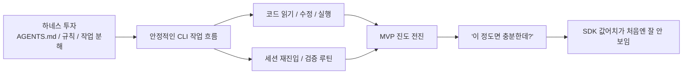

> **핵심 요약**
>
> 내 경험에서는 CLI가 약해서 Agents SDK를 찾은 것이 아니었다. 오히려 `AGENTS.md`, skills, 저장소 규칙, 작업 분해, 검증 습관 같은 하네스를 먼저 단단히 깔아두고 나니 CLI만으로도 꽤 멀리 갈 수 있었다. 당시 내가 풀던 범위에서는 그 조합만으로도 MVP를 밀기에 충분해 보였다. 그래서 처음에는 SDK가 왜 필요한지, 정확히 어디서 값어치를 만드는지 잘 보이지 않았다.

## 문제의식

이 시리즈는 Agents SDK를 소개하려는 글이 아니다. 오히려 반대로, 왜 한동안 나는 SDK의 차별점을 잘 체감하지 못했는지를 정리하는 글에 가깝다.

이 질문은 생각보다 중요하다. 이미 CLI 기반 하네스를 오래 다뤄 본 개발자라면 비슷한 감각을 한 번쯤 느낀다.

`좋은 프롬프트, 저장소 규칙, 작업 분해만 잘 잡으면 이미 꽤 많은 일이 되는데, 여기서 SDK가 본질적으로 무엇을 더 주는 걸까?`

나도 처음에는 그랬다. 특히 MVP를 밀어야 하는 상황에서는 더 그랬다. 기능 하나를 빠르게 끝내고, 테스트를 돌리고, 문서를 맞추고, 다음 세션에서 바로 이어붙일 수 있으면 일단 작업은 굴러간다. 그때 눈에 먼저 들어오는 것은 실행력이다. 누가 더 잘 읽고, 더 잘 고치고, 더 빨리 결과를 내느냐가 우선순위처럼 보인다.

그런데 시간이 지나고 보니, 적어도 내 경험에서는 내가 정말 크게 의존했던 것은 모델의 미세한 차이보다 하네스였다. 저장소를 어떻게 해석할지, 어떤 문서를 먼저 읽을지, 현재 상태와 목표 상태를 어떻게 분리할지, 작업을 어느 단위로 자를지, 어디서 검증을 멈추고 다시 확인할지를 미리 고정해 둔 구조가 더 큰 차이를 만들고 있었다.

## 왜 나는 CLI에 강하게 투자했는가

CLI는 단순히 "터미널에서 부르는 에이전트"가 아니었다. 적어도 내가 쓰던 방식에서는, 저장소 해석 규칙과 세션 운영 규칙을 같이 실어 나르는 작업 인터페이스에 가까웠다.

예를 들어 내가 실제로 강하게 의존한 요소는 대체로 비슷했다.

- `AGENTS.md`로 저장소 목적, 기준 문서, 읽기 순서, 금지할 오해를 먼저 고정한다.
- skills나 내부 규칙으로 특정 작업의 절차를 짧게 재사용한다.
- 한 번에 큰 목표를 던지지 않고, 파일 소유권과 범위를 잘라서 작업 단위로 분해한다.
- 필요하면 서브에이전트처럼 역할을 쪼개서 읽기, 쓰기, 검증, 비교를 나눈다.
- 결과를 바로 믿지 않고 테스트, diff, 문서 일치 여부, 파일 존재 여부를 다시 확인한다.

이 조합이 강했던 이유는 단순하다. 사람 머릿속에서만 굴러가던 운영 규칙이 적어도 텍스트와 절차의 형태로 밖으로 나왔기 때문이다.

물론 이 모든 것은 여전히 사람 주도다. 누가 어떤 작업을 먼저 할지, 어디까지를 한 세션의 범위로 볼지, 어떤 문서를 먼저 읽게 할지, 검증 실패를 어떻게 처리할지는 사람이 설계한다. 하지만 그 설계가 문서와 규칙으로 고정되어 있으면, CLI는 단순한 대화창이 아니라 꽤 강한 실행 하네스가 된다.

## 내가 실제로 썼던 하네스 요소

여기서 중요한 것은 "CLI를 잘 쓴다"보다 "CLI 주변에 어떤 운영 장치를 깔아두었는가"였다.

### `AGENTS.md`가 먼저 저장소를 해석하게 만든다

좋은 하네스에서 가장 먼저 하는 일은 코드를 읽는 것이 아니라 저장소를 읽는 방식부터 고정하는 것이다. 이 블로그 저장소만 봐도 마찬가지다. `_posts`는 아직 placeholder이고, `outlines`가 편별 브리프이며, `references`는 근거 패키지이고, `docs/execution`은 작업 운영 문서다. 이 해석을 먼저 고정하지 않으면, 에이전트는 placeholder를 완성본처럼 다루거나 열린 질문을 사실처럼 단정해 버리기 쉽다.

즉, 좋은 하네스는 "무엇을 할 것인가"보다 먼저 "이 저장소를 어떻게 읽을 것인가"를 정한다.

### skills와 규칙은 반복되는 절차를 짧게 만든다

작업을 반복하다 보면 자주 돌아오는 절차가 생긴다. 먼저 읽어야 할 문서, 검증 순서, 편집 범위, 금지할 실수 같은 것들이다. 이걸 매번 긴 프롬프트로 다시 설명할 수도 있지만, skills나 저장소 규칙으로 압축해 두면 세션 진입 비용이 확연히 낮아진다.

특히 MVP 작업에서는 이 진입 비용이 무시하기 어렵다. 기능 자체보다 "이번엔 어디부터 읽어야 하지?"라는 재정렬 비용이 더 크기 쉽기 때문이다.

### 작업 분해가 품질보다 속도를 더 잘 지켜준다

처음에는 작업 분해를 품질 관리 장치로만 생각했다. 그런데 내 경험에서는 실제로 속도를 지키는 데 더 큰 도움이 됐다. 범위를 잘라두면 한 세션 안에서 무엇을 끝내야 하는지가 선명해지고, 실패했을 때도 어디서 다시 시작해야 하는지가 명확해진다.

이건 단순히 일을 잘게 쪼개자는 얘기가 아니다. 프론트엔드, 백엔드, 테스트, 문서를 한꺼번에 밀지 않고, 지금 닫아야 하는 작업 단위를 고정하는 것이 중요했다. 그래야 CLI가 강한 실행기로 작동한다.

### 서브에이전트 스타일 분해는 이미 꽤 많은 것을 해결한다

나는 멀티에이전트를 처음부터 "여러 프로세스를 병렬 실행하는 시스템"으로 체감하지는 않았다. 오히려 먼저 체감한 것은 역할 분해였다. 어떤 세션은 참고 자료를 정리하는 역할, 어떤 세션은 본문만 쓰는 역할, 어떤 세션은 검증만 하는 역할로 잘라두는 것만으로도 결과가 훨씬 안정적이었다.

즉, 서브에이전트 스타일 분해는 SDK가 와야만 가능한 일이 아니었다. CLI 환경에서도 충분히 흉내 낼 수 있었고, 실제로 실무에서는 그 정도만으로도 큰 효과가 났다.

## 왜 이 조합이 실제로 강력했는가

내가 CLI만으로도 충분하다고 느낀 출발점은, 이 하네스가 실제 작업에서 꽤 구체적으로 작동했기 때문이다. 중요한 것은 "좋은 프롬프트를 썼다"보다, 세션이 바뀌어도 같은 방식으로 다시 들어오고 같은 체크를 반복하게 만드는 장치가 이미 있었다는 점이다.

첫째, 저장소 재진입이 쉬워졌다. 새 세션이 들어와도 어떤 문서를 먼저 읽고, 현재 상태를 어떻게 해석하고, 어디까지를 기준 문서로 볼지 빠르게 맞출 수 있었다. 세션이 끊길 때마다 맥락을 다시 발명하지 않아도 된다는 뜻이다.

둘째, 품질 하한선을 올릴 수 있었다. 단순히 "잘 써줘"라고 말하는 대신, 읽기 순서, 근거 우선순위, 수정 범위, 검증 규칙을 박아두면 결과 편차가 줄어든다. 프롬프트를 잘 쓰는 것과 운영 규칙을 깔아두는 것은 다르다. 후자가 있어야 전자가 반복 가능해진다.

셋째, 검증 루틴을 일상 작업 안에 넣을 수 있었다. 파일이 실제로 생겼는지, 요청한 범위만 수정했는지, 테스트가 도는지, 문서와 구현이 어긋나지 않는지 같은 확인을 세션 끝 체크처럼 반복할 수 있었다. 완전한 시스템 강제는 아니어도, 하네스가 최소한의 안전레일 역할은 해줬다.

즉, 이 섹션에서 말하고 싶은 핵심은 단순하다. 내가 강하게 느낀 값어치는 CLI 자체의 대화 능력보다, 그 주변에 깔아둔 해석 규칙과 재진입 루틴, 검증 습관이 실제로 작동했다는 데 있었다.

그래서 당시 내 결론은 자연스러웠다. 이미 강한 CLI 위에 하네스를 잘 깔아두는 쪽이, 적어도 내 작업 방식에서는 가장 실용적으로 보였다.

## MVP 단계에서 CLI가 충분했던 이유

여기서 말하는 "충분했다"는 것은 모든 면에서 최선이었다는 뜻이 아니다. 다만 적어도 내가 당시 다루던 MVP 범위와 작업 밀도에서는, CLI 하네스가 이미 충분히 높은 효율을 줬다는 뜻이다.

내 경험에서 특히 CLI가 잘 맞았던 MVP는 대체로 이런 특성이 있었다.

- 정답보다 속도가 중요하다.
- 운영 체계보다 기능 진도가 먼저 보인다.
- 조정 역할이 한 사람에게 있어도 버틸 수 있다.
- 실패해도 빠르게 다시 시도할 수 있다.
- 추적성과 감사 가능성보다 당장 배포 가능한 산출물이 우선이다.

이런 환경에서는 사람 주도 진행이 크게 부담되지 않는다. 오히려 직접 조정하는 편이 빠를 때가 많다. 어떤 작업을 지금 자를지, 무엇을 다음 세션으로 넘길지, 어느 규칙은 강하게 지키고 어느 규칙은 유연하게 넘길지를 사람이 즉석에서 판단해도 비용이 아직 크지 않기 때문이다.

그래서 처음에는 Agents SDK를 봐도 차이가 선명하게 보이지 않았다. 내가 체감하는 핵심 병목은 "코드를 더 잘 쓰는가" 혹은 "더 많은 역할을 붙일 수 있는가"가 아니라, 지금 이 저장소에서 다음 산출물을 얼마나 빨리 안정적으로 밀어낼 수 있는가였기 때문이다. 적어도 그 시점의 내 문제 크기에서는, CLI 하네스가 이미 꽤 좋은 답이었다.

## 그때는 잘 보이지 않았던 부분

하지만 충분하다는 감각이 곧 한계가 없다는 뜻은 아니었다. 다만 1편에서 강조하고 싶은 것은 "그래서 곧바로 SDK가 필요했다"가 아니다. 내 경험에서는 오히려 반대였다. CLI가 이미 충분히 강했고, 하네스도 잘 작동하고 있었기 때문에, 그 다음 단계의 문제가 무엇인지 처음에는 또렷하게 보이지 않았다.

가끔씩은 이런 생각이 스쳤다. 세션이 늘어나고 역할이 많아지면 지금 방식이 언제까지 그대로 편할까. 하지만 당시 내가 풀던 범위에서는 그 질문이 아직 급한 문제는 아니었다. 그래서 Agents SDK를 처음 봤을 때도 "이건 결국 CLI를 한 겹 감싼 것 아닌가?"라는 인상이 먼저 왔다.

## 비슷한 작업 저장소 사례가 왜 떠올랐는가

이 지점에서 떠오르는 비교가 있었다. 예전에 다뤘던 한 작업 저장소는 코드만 있는 곳이 아니라, 다음 세션이 같은 규칙으로 다시 들어오도록 운영 문서를 함께 갖춘 저장소였다.

이 사례는 OpenAI 기능의 근거가 아니라, 좋은 하네스가 왜 강력했는지를 보여주는 비교 예시에 가깝다. 내가 CLI에 강하게 투자했던 이유도 비슷했다. 실제 차이를 만든 것은 실행기 하나의 우열보다, 그 실행기를 둘러싼 해석 규칙과 작업 운영 구조였다.

그리고 바로 그 경험 때문에, 새로운 도구를 볼 때도 먼저 "얼마나 더 잘 코딩하느냐" 쪽으로 보게 됐다. 1편은 그 시점의 감각, 즉 SDK의 값어치가 아직 선명하게 보이지 않던 상태를 설명하는 글이다.

## 정리

처음에 나는 CLI만으로도 충분하다고 생각했다. 지금 돌아보면 그 판단은 오해라기보다, 당시 문제 설정에 꽤 잘 맞는 현실적인 판단이었다. `AGENTS.md`, skills, 저장소 규칙, 작업 분해, 서브에이전트 스타일 분업, 검증 습관 같은 하네스를 잘 깔아두면 CLI는 이미 상당히 강한 작업자였다. 특히 내 경험에서는 MVP 단계에서 그 조합이 속도와 품질의 균형을 꽤 잘 맞춰 줬다.

그래서 당시에는 SDK를 봐도 "결국 이건 CLI를 코드로 감싼 것 아닌가?"라는 생각이 먼저 들었다. 그 의심은 나름대로 정당했다. 적어도 그때 내가 풀던 범위에서는, 아직 CLI 바깥의 다른 층을 또렷하게 체감할 이유가 많지 않았기 때문이다.

다음 글에서는 바로 그 자연스러운 의심을 더 정면에서 다뤄보려 한다. 왜 Agents SDK가 처음에는 래퍼처럼 보였는지, 그리고 그 오해가 어디까지 맞고 어디서부터 틀어지기 시작하는지를 이어서 정리해보겠다.
