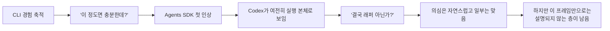

> [!summary]
> Agents SDK를 처음 봤을 때 내가 "결국 CLI를 코드로 감싼 것 아닌가?"라고 반응한 것은 꽤 자연스러웠다. 공식 자료를 보수적으로 읽어도 실제 실행의 중심은 여전히 Codex였고, 표면적으로는 CLI 하네스를 프로그래밍 방식으로 옮겨놓은 것처럼 보였기 때문이다. 그래서 이 의심은 절반쯤 맞다. 다만 그 프레임만으로 보면 놓치는 층이 하나 있는데, 그 지점을 다음 글에서 풀어보려 한다.

## 문제의식

1편에서 정리했듯, 나는 CLI가 부족해서 Agents SDK를 찾은 것이 아니었다. 이미 `AGENTS.md`, 저장소 해석 규칙, 작업 분해, 검증 루틴 같은 하네스를 꽤 강하게 깔아두고 있었고, 그 조합만으로도 실제 작업이 많이 굴러갔다. 그러니 SDK를 처음 봤을 때 가장 먼저 든 생각도 자연스러웠다.

`이거, 결국 CLI를 코드에서 부르는 방식으로 바꾼 것 아닌가?`

지금 돌아보면 이 질문은 성급한 냉소라기보다, 당시의 내 작업 감각에 정직한 반응이었다. 이미 CLI로 충분히 멀리 가 본 사람이라면 비슷한 인상을 받기 쉽다. 특히 저장소형 작업을 자주 하는 개발자일수록 그렇다. 코드 읽기, 수정, 실행, 문서 갱신, 검증 같은 흐름이 이미 손에 익어 있다면, 새로 등장한 SDK가 과연 무엇을 본질적으로 바꾸는지 바로 체감하기 어렵다.

이 글은 그 첫 반응이 왜 자연스럽고, 왜 어느 정도는 합리적이었는지를 정리하는 글이다. 중요한 것은 SDK를 과소평가하려는 것이 아니라, 이 질문을 통과해야만 SDK를 과장하지도 않게 된다는 점이다.

## 첫 인상: wrapper처럼 보였던 이유

처음 공식 가이드와 예제를 훑어볼 때, 내 눈에 먼저 들어온 것은 "무엇이 실행을 담당하는가"였다. 그 시선으로 보면 풍경은 꽤 익숙하다. Codex가 코드를 읽고, 수정하고, 실행한다. CLI에서 보던 바로 그 강한 실행기가 여전히 중심에 있는 것처럼 보인다.

`references/official_source_notes.md`를 기준으로 보수적으로 정리해도, Agents SDK 가이드는 Codex를 MCP server로 연결하고 그 위에서 단일 에이전트 또는 여러 역할을 가진 에이전트 흐름을 구성하는 그림을 보여준다. Cookbook notebook 메모도 비슷하다. 도입부에서 consistency, repeatability, observability 같은 단어를 강조하지만, 막상 손에 잡히는 장면은 결국 Codex가 실제 작업을 수행하는 장면이다.

그렇다면 CLI에 익숙한 사람은 이렇게 생각하게 된다.

- 실행 본체는 여전히 Codex다.
- Codex를 부르는 방식만 터미널에서 코드로 옮겨온 것 같다.
- 역할을 나누고 순서를 붙이는 것도, 얼핏 보면 사람이 하던 작업 분해를 코드로 적은 정도처럼 보인다.

즉, 첫 인상만 놓고 보면 SDK는 "새로운 실행기"라기보다 "익숙한 실행기를 다루는 프로그래밍 인터페이스"처럼 보인다. 내가 wrapper라는 표현을 먼저 떠올린 것도 이 때문이었다.

## 실제로 CLI와 SDK가 겹치는 영역

이 반응이 단순한 오해가 아니었던 이유는, CLI와 SDK가 실제로 겹치는 영역이 분명 있기 때문이다. 이 겹침을 인정하지 않으면 오히려 설명이 부정확해진다.

첫째, 둘 다 결국 강한 실행기를 전제로 한다. 코드베이스를 읽고, 파일을 수정하고, 필요하면 실행하고, 도구를 호출하는 쪽의 체감은 여전히 실행기에서 나온다. 내가 처음 SDK를 봤을 때 "와, 완전히 다른 종류의 agent다"라는 인상을 받지 못했던 이유도 여기에 있다.

둘째, 역할 분해 자체는 CLI에서도 어느 정도 가능하다. 사람은 이미 프롬프트와 문서 규칙으로 역할을 나눌 수 있다. 예를 들어 어떤 세션은 참고 자료만 정리하게 하고, 어떤 세션은 본문만 쓰게 하고, 어떤 세션은 검증만 돌리게 하는 식의 분리는 CLI 환경에서도 충분히 해왔다. 서브에이전트 스타일의 분업 또한 완전히 낯선 개념이 아니었다.

셋째, 강한 하네스를 가진 CLI 워크플로우는 생각보다 운영 냄새가 난다. 저장소 해석 규칙, 읽기 순서, 수정 범위, 검증 체크리스트가 이미 문서로 고정되어 있다면, 겉보기에는 "우리는 이미 꽤 체계적으로 운영하고 있다"는 감각이 생긴다. 그러면 SDK가 하는 일이 기존 하네스를 코드로 옮긴 것처럼 보이기 쉽다.

이 지점 때문에, "결국 래퍼 아닌가?"라는 반응은 절반쯤 맞는 말이 된다. 적어도 실행력의 본체를 바라보는 한에서는, SDK가 갑자기 전혀 다른 종류의 존재로 보이지 않는다.

## 이 의문이 중요한 이유

여기서 이 질문을 너무 빨리 치워버리면 시리즈의 기준이 흐려진다. 하나는 CLI를 일부러 약하게 그려 SDK를 돋보이게 만드는 실수다. 다른 하나는 SDK를 큰 단어로만 설명해서, 왜 기존 CLI 사용자에게 처음엔 래퍼처럼 보였는지 건너뛰는 실수다.

내가 보기에 이 포스트의 역할은 바로 여기 있다. SDK의 가치를 바로 단정하지 않고, 왜 많은 실무자가 처음에는 그 가치를 잘 못 느끼는지 먼저 설명하는 것이다. 이 질문을 정직하게 통과해야만 `CLI vs SDK`를 세대 교체 서사로 보지 않게 된다.

## 왜 이 인상이 오래 갔는가

이 인상이 오래 간 핵심 이유는, 이미 하네스를 가진 사람에게 SDK의 차이가 처음에는 "새 능력"보다 "도입 비용"으로 읽히기 쉽기 때문이다. CLI에서는 내가 직접 작업 범위를 자르고, 읽기 순서를 정하고, 다음 단계로 넘길 타이밍을 잡는다. SDK 예제에서는 그 분해가 Project Manager, Designer, Frontend, Backend, Tester 같은 역할로 코드 안에 들어가 있었다. 하지만 첫눈에는 그것이 본질적 차이라기보다, 내가 이미 하던 coordinator 역할을 더 명시적으로 적은 것처럼 보였다.

그래서 판단은 쉽게 보수적으로 굳는다. `지금도 충분히 굴러가는데, 굳이 왜 이 구조를 다시 코드로 옮겨야 하지?`

문제는 여기서 끝나지 않았다는 점이다. 시간이 지나며, 이 설명만으로는 공식 예제가 유난히 반복해서 강조하던 handoff, trace, approval, gating의 무게가 잘 설명되지 않았다. 바로 그 미해결 긴장이 다음 글의 출발점이다.

## 다음 글로 이어질 질문

그래서 이 글의 결론은 "`wrapper`라는 인상이 틀렸다"가 아니다. 더 정확한 정리는 이쪽에 가깝다.

`그 인상은 자연스럽고 부분적으로 맞았다. 하지만 그것만으로는 충분하지 않았다.`

다음 글에서는 바로 그 부족한 층, 즉 실행력 바깥의 운영 제어면이 왜 별도의 문제로 보이기 시작했는지를 이어서 보겠다.
