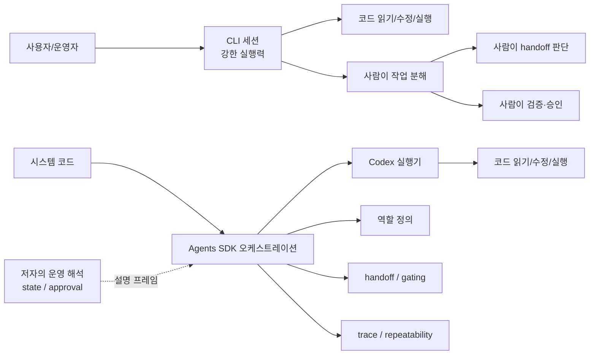

> [!summary]
> 처음에는 Agents SDK가 결국 CLI를 코드로 감싼 래퍼처럼 보였다. 그런데 공식 가이드와 예제를 다시 읽고 나니 차이는 모델의 우열이 아니라 운영 제어면에 있었다. CLI는 여전히 강력한 실행기이고, SDK는 그 실행을 역할 분리, handoff, guardrail, trace 같은 구조 안에 넣어 반복 가능한 시스템으로 조직한다. 그래서 SDK의 의미는 "더 잘 코딩한다"가 아니라 "같은 방식으로 계속 운영할 수 있다"에 더 가깝다.

## 문제의식

이 시리즈에서 내가 가장 늦게 이해한 지점이 바로 여기였다. CLI 기반 하네스를 오래 만져본 사람일수록 Agents SDK를 처음 보고 이렇게 생각하기 쉽다.

`좋은 프롬프트와 저장소 규칙만 있으면 이미 꽤 많은 걸 할 수 있는데, 여기서 SDK가 본질적으로 뭘 더 주는 걸까?`

이 질문 자체는 틀리지 않았다. 실제로 CLI는 이미 강력한 작업자다. 코드를 읽고, 수정하고, 실행하고, 필요하면 도구를 부르고, 규칙을 따르게 만들 수 있다. 나 역시 `AGENTS.md`, skills, 작업 분해 규칙 같은 하네스를 잘 짜면 꽤 멀리 갈 수 있다고 느껴왔다.

문제는 여기서 생긴다. 강한 실행기 하나를 잘 다루는 것과, 여러 역할과 검증 단계를 가진 작업 흐름을 반복 가능한 형태로 운영하는 것은 같은 문제가 아니었다.

## 처음 가졌던 생각

처음에는 SDK를 이렇게 이해했다.

- CLI에서 하던 일을 코드에서 호출할 수 있게 만든 것
- 멀티에이전트를 조금 더 편하게 묶는 도구
- 결국 본체는 Codex고, SDK는 그 바깥 래퍼

이 관점이 완전히 틀린 것은 아니다. 실제 실행은 여전히 Codex 같은 실행기가 담당한다. 그래서 표면만 보면 "좋은 실행기를 다른 방식으로 감싼 것"처럼 보이기 쉽다.

하지만 이 이해만으로는 중요한 차이를 놓치게 된다. 이 관점은 실행기만 보고 운영 구조를 보지 않는다. 내가 처음에 SDK의 가치를 체감하지 못했던 이유도 여기에 있었다. 나는 이미 CLI 하네스로 많은 운영 공백을 사람이 직접 메우고 있었고, 그래서 그 메움 자체를 별도의 문제로 보지 못했다.

## 확인한 내용

공식 자료를 다시 보면서 시야가 바뀌었다. OpenAI의 Codex용 Agents SDK 가이드는 "더 강한 코딩 모델이 하나 더 생겼다"는 식으로 설명하지 않는다. 오히려 Codex를 MCP 서버로 연결하고, 그 위에 Project Manager와 역할별 에이전트를 두어 handoff와 guardrail을 관리하는 멀티에이전트 워크플로우를 보여준다.

이 가이드에서 눈에 들어온 부분은 세 가지였다.

첫째, 역할이 분리되어 있다. Project Manager, Designer, Frontend, Backend, Tester가 각각 자기 범위와 산출물을 가진다. 중요한 것은 역할 수가 아니라, 누가 무엇을 만들고 언제 다음 단계로 넘길지를 시스템 구조로 고정한다는 점이다.

둘째, handoff에 조건이 붙어 있다. Project Manager는 필요한 파일이 실제로 생성되었는지 확인한 뒤에만 다음 역할로 넘긴다. 즉 "대충 됐겠지"가 아니라, 산출물 존재와 단계 전환 조건이 워크플로우 자체에 들어간다.

셋째, trace가 운영의 일부로 붙는다. 공식 가이드는 prompt, tool call, hand-off, file write, 실행 시간 같은 흐름을 trace로 확인하는 예시를 보여준다. 이건 디버깅 편의 기능 정도가 아니라, 운영 흐름이 실제로 어떻게 흘렀는지 나중에 감사하고 설명할 수 있게 해주는 장치다.

여기서 비로소 문장이 정리됐다. SDK의 핵심은 실행기를 바꾸는 데 있기보다, 이미 강한 실행기를 여러 역할과 검증 흐름 안에서 반복 가능하게 다루는 데 있었다.

## 실행력과 운영은 다른 문제였다

이 차이를 가장 짧게 말하면 이렇다.

- 실행력은 "한 번 잘 해내는 능력"에 가깝다.
- 운영은 "여러 번 비슷한 방식으로 굴러가게 만드는 구조"에 가깝다.

CLI 중심 작업에서는 사람이 오케스트레이터다. 사람이 지금 필요한 단계를 정하고, 누가 다음 일을 해야 하는지 판단하고, 산출물이 충분한지 확인하고, 막히면 우회한다. 잘 숙련된 개발자라면 이 일을 꽤 잘한다. 그래서 CLI만으로도 실제 생산성이 높다.

하지만 이 방식은 사람이 상태를 많이 들고 있어야 한다. 예를 들어 Top-10 leaderboard 기능을 추가한다고 해보자. 프론트엔드, 백엔드, 테스트, 문서가 함께 움직여야 한다면, CLI만으로도 작업은 된다. 다만 보통은 이런 질문이 계속 사람 머리 안에서 돌아간다.

- 지금 backend가 먼저 끝나야 하나, frontend가 먼저 끝나야 하나
- tester에게 넘기기 전에 무엇이 준비되어 있어야 하나
- 누가 만든 산출물이 다음 단계의 입력이 되는가
- 중간에 빠진 파일이나 검증 누락은 없는가

이 질문을 사람이 계속 붙들고 있으면, 실행은 강하지만 운영은 사람 의존적이 된다.

반대로 SDK를 쓸 때 중요해지는 것은 실행기 자체보다 운영 제어 구조다. 내가 이 글에서 `control plane`이라고 부르는 것도 바로 그 층인데, 공식 문서가 그 용어를 전면에 내세운다기보다 역할 분리, handoff, guardrail, trace 같은 장치를 통해 그런 구조를 보여준다고 보는 편이 더 정확하다. 누가 조정 역할을 맡는지, 어떤 조건에서 handoff되는지, 어디서 검토를 멈추고 다음 단계로 넘길지, 어떤 trace를 남길지가 코드와 런타임 쪽으로 더 많이 이동한다.

이 지점부터는 도구 사용이 아니라 운영 설계의 문제다.

## 프롬프트로 유도하는 것과 코드로 강제하는 것

이 차이는 생각보다 실무적이다.

CLI 하네스에서도 우리는 많은 것을 프롬프트로 유도할 수 있다. `AGENTS.md`로 저장소 해석 규칙을 고정하고, 역할을 나누고, 특정 순서로 읽게 만들고, 검증 원칙을 강하게 심을 수 있다. 실제로 이 방식은 매우 강력하다. 사람 한 명이 주도권을 쥔 상태에서 빠르게 밀어붙여야 하는 작업에는 오히려 이런 유연성이 더 낫다.

하지만 프롬프트 약속은 결국 "따르도록 유도하는 것"에 가깝다. 잘 설계하면 매우 안정적이지만, 단계 전환과 검증 조건이 시스템 구조 안에 명시되는 것은 아니다. 누가 언제 무엇을 검증해야 하는지, 어떤 아티팩트가 있어야 다음 역할로 넘어갈 수 있는지, 그 실행 흔적을 어떻게 남길지는 보통 운영자가 계속 붙들고 있게 된다.

SDK가 중요한 이유는 여기서 나온다. 같은 규칙을 런타임 구조로 더 직접 표현할 수 있기 때문이다.

- role과 responsibility를 코드로 정의한다.
- handoff 조건을 흐름으로 고정한다.
- 산출물과 단계 전환을 추적하기 쉬워진다.
- trace를 통해 실행 경로를 나중에 다시 본다.
- gating, 그리고 내가 해석상 `approval`이라고 부르는 검토 지점을 구조 안에 두기 쉬워진다.

이건 "더 엄격해서 좋다"는 추상적 미덕이 아니다. 사람이 매번 같은 체크리스트를 다시 연기하지 않아도 된다는 뜻이다.

## handoff / gating / state / trace / approval을 실무적으로 보면

이 단어들은 멀티에이전트 문맥에서 자주 보이지만, 추상적으로만 들리면 실제 경계가 잘 안 보인다. 공식 자료에서 강하게 확인되는 것은 handoff, guardrail, trace, 역할 분리, 반복 가능성 쪽이다. 아래에서 `state`와 `approval`은 공식 기능명을 그대로 옮긴다기보다, 그 구조를 실무 감각으로 풀어낸 내 쪽 해석에 가깝다.

### handoff

handoff는 단순히 다음 에이전트를 부르는 일이 아니다. 어떤 산출물과 문맥을 다음 역할로 넘길지를 분명히 하는 일이다. Designer가 아이디어만 말로 넘기는 경우와 `design_spec.md` 같은 명시적 아티팩트를 남기고 넘기는 경우를 비교해 보면, 차이는 바로 다음 단계의 입력이 얼마나 고정되어 있느냐에 있다.

### gating

gating은 다음 단계로 넘어가기 전에 필요한 조건을 확인하는 장치다. OpenAI 가이드에서 Project Manager가 필요한 파일이 있는지 확인한 뒤 다음 handoff로 넘어가는 구조가 바로 그 예시다. 중요한 것은 gating이 속도를 늦추기 위한 절차가 아니라, 나중의 더 큰 재작업을 막는 운영 장치라는 점이다.

### state

내가 여기서 말하는 `state`는 "공식 기능 이름"이라기보다, 지금 워크플로우가 어디까지 왔는지, 어떤 아티팩트가 생성됐는지, 무엇이 보류 상태인지 같은 운영 정보를 가리킨다. CLI 중심 환경에서는 이런 상태를 사람이 기억하거나 문서로 보조하는 경우가 많고, SDK 쪽으로 가면 이런 정보를 코드와 런타임 흐름 옆에 더 일관되게 둘 수 있다는 점이 중요하게 느껴졌다.

### trace

trace는 결과만 보는 것이 아니라 과정 자체를 다시 보는 창이다. 누가 어떤 지시를 받았고, 어떤 도구를 썼고, 어디서 handoff됐고, 어떤 파일이 생성됐는지를 따라갈 수 있어야 운영 흐름을 디버깅할 수 있다. 이건 단지 로그가 예쁘다는 문제가 아니라, 반복 실행되는 시스템에서 신뢰를 만들기 위한 최소 장치에 가깝다.

### approval

내가 여기서 쓰는 `approval`도 공식 문서의 단일 기능명을 인용한다기보다, 어떤 단계는 자동으로 밀고 가고 어떤 단계는 사람이나 상위 역할의 확인을 거치게 할지 정하는 운영 결정 지점을 넓게 가리킨다. 중요한 것은 승인이라는 단어 자체보다, 그런 검토와 통제가 사람의 즉흥 판단에만 남지 않고 흐름 설계 안으로 들어온다는 점이다.

## 왜 이 차이가 실무적으로 중요한가

실무에서는 보통 "무엇이 더 강력한가"보다 "어디까지는 사람 주도로 밀고 갈 수 있고, 어디서부터는 운영 구조가 필요해지는가"가 더 중요하다.

내 기준에서 CLI만으로도 충분한 구간은 분명하다.

- 작업 범위가 비교적 작다.
- 한 명이 전체 맥락을 유지할 수 있다.
- 산출물 검증을 사람이 직접 해도 부담이 크지 않다.
- 세션이 바뀌어도 손실이 크지 않다.

반대로 SDK가 의미를 갖는 구간도 분명하다.

- 역할 분리가 반복된다.
- 같은 handoff 구조를 여러 번 재사용해야 한다.
- 누락 없이 단계별 검증을 통과시켜야 한다.
- trace와 감사 가능성이 중요하다.
- 운영자가 매번 coordinator 역할을 수동으로 연기하는 비용이 커진다.

이때 SDK는 실행기의 상위 호환이라기보다 운영 방식의 전환으로 이해하는 편이 더 정확하다.

## `hello-android`를 떠올리면 더 명확해진다

이 차이를 이해할 때 떠오른 비교가 `hello-android`였다. 그 저장소는 하네스와 문서 운영 구조가 들어오면서 "코드만 있는 곳"에서 "다음 작업을 같은 방식으로 다시 시작할 수 있는 곳"으로 성격이 바뀌었다.

이 사례는 OpenAI 제품의 근거가 아니다. 다만 운영 구조가 왜 중요한지 설명하는 비유로는 유용하다. 실행기 자체가 갑자기 더 똑똑해진 것이 아니라, 그 실행을 둘러싼 해석 규칙, task 단위, 다음 세션 진입점이 생기면서 작업이 반복 가능해졌기 때문이다.

나는 Agents SDK를 이해할 때도 비슷한 감각을 느꼈다. 핵심은 "더 잘하는 한 번"보다 "같은 방식으로 다시 굴러가는 구조"였다.

## 정리

처음에는 Agents SDK를 CLI의 프로그래밍 래퍼처럼 봤다. 그런데 그 관점으로는 왜 공식 가이드가 handoff, guardrail, trace, 역할 분리, 단계별 검증을 그렇게 강조하는지 설명이 잘 되지 않았다. 지금은 정리가 더 단순하다. CLI는 여전히 강한 실행기이고, Agents SDK는 그 실행을 역할과 검증 흐름 안에서 반복 가능하게 조직하는 쪽에 가깝다. 그래서 차이는 모델의 우열보다 운영 방식에 있다.

이 구분을 받아들이고 나니 "SDK가 더 좋은가?"라는 질문보다 "지금 나는 강한 실행기를 쓰는 단계인가, 아니면 반복 가능한 운영 체계를 짜는 단계인가?"라는 질문이 더 중요해졌다.

다음 글에서는 이 경계를 말로만 두지 않고, 같은 leaderboard 작업을 CLI 중심 방식과 SDK까지 올린 방식으로 나란히 비교해보겠다. 그때부터는 이 차이가 개념이 아니라 작업 감각으로 보이기 시작한다.
