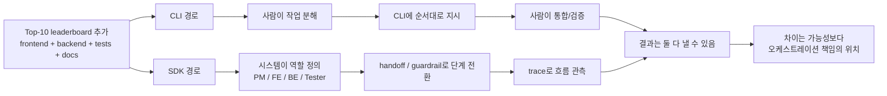

> **핵심 요약**
>
> 같은 leaderboard 기능 추가는 CLI만으로도 충분히 해낼 수 있다.
> 이 글의 비교 포인트는 기능 가능 여부가 아니라 오케스트레이션 책임의 위치다.
> CLI 경로에서는 사람이 분해·통합·검증을 붙들고, SDK 경로에서는 그 흐름을 역할·handoff·trace로 구조화한다.
> 핵심 차이는 실행기의 우열이 아니라 운영 방식이다.

## 비교 예제부터 고정해보자

이번 글에서는 시리즈 전체에서 공통으로 쓰는 예제를 그대로 가져온다. 기존 React + Node/Express 저장소에 Top-10 leaderboard 기능을 추가하는 상황이다.

- backend: `GET /scores`, `POST /scores`
- frontend: leaderboard UI 추가
- tests: API와 UI smoke test
- docs: README 업데이트

이 예제가 좋은 이유는 단순하다. 프론트엔드 한 파일만 고치고 끝나는 일이 아니기 때문이다. 백엔드, UI, 테스트, 문서가 같이 움직여야 해서, "하나의 강한 실행기에게 잘 시키는 문제"와 "여러 단계의 작업 흐름을 어떻게 운영하는가"를 나란히 보기 좋다.

이 기능은 두 방식 모두로 충분히 만들 수 있다. 그래서 비교의 초점은 "무엇이 가능하냐"보다 "누가 이 작업 흐름을 운영하느냐"에 있다.

## 처음에는 이렇게 생각하기 쉽다

CLI 하네스를 오래 써 본 사람이라면 이런 반응이 자연스럽다.

`이 정도 기능이면 그냥 잘게 쪼개서 시키면 되지 않나?`

실제로 맞는 말이다. `AGENTS.md`, 저장소 규칙, skills, 파일 단위 ownership, 테스트 습관이 이미 잡혀 있다면 CLI만으로도 leaderboard 같은 기능은 충분히 밀 수 있다. 나도 처음에는 SDK 쪽의 우위가 아주 선명하지 않았다. 기능 추가 자체는 이미 CLI 쪽에서도 잘 되기 때문이다.

그런데 [OpenAI의 Agents SDK 가이드](https://developers.openai.com/codex/guides/agents-sdk)와 companion 성격의 [Cookbook notebook](https://github.com/openai/openai-cookbook/blob/main/examples/codex/codex_mcp_agents_sdk/building_consistent_workflows_codex_cli_agents_sdk.ipynb)을 다시 읽고 나니, 비교 질문 자체를 바꿔야 한다는 생각이 들었다. 둘의 차이는 "같은 일을 할 수 있느냐"보다 "그 일을 누가, 어떤 구조로 운영하느냐"에 있었다.

## CLI만으로 하는 방식

CLI 경로를 먼저 보자. 여기서 Codex는 여전히 강한 실행기다. 코드를 읽고, 수정하고, 실행하고, 테스트를 돌리고, 필요하면 여러 파일을 건드릴 수 있다. 문제는 실행력이 아니라 그 실행을 어떤 방식으로 이어 붙이느냐다.

실제 흐름은 대체로 이런 식이다.

1. 사람이 전체 요구사항을 정리한다.
2. 사람이 지금 세션에서 닫아야 할 범위를 자른다.
3. CLI에 backend부터 시킬지, UI부터 시킬지, 혹은 테스트용 브랜치를 먼저 정리할지 판단해 지시한다.
4. 중간 결과를 보고 다음 작업으로 handoff할지, 다시 수정시킬지 결정한다.
5. 마지막에 사람이 프론트엔드/백엔드/테스트/문서를 통합 검토한다.

즉, CLI 경로의 핵심은 사람 주도 오케스트레이션이다. 작업 분해, 순서 결정, 다음 단계로 넘길 타이밍을 사람이 계속 쥔다.

예를 들어 leaderboard 작업을 CLI 중심으로 굴리면 보통 이런 식의 운영 감각이 나온다.

- 먼저 API shape를 정한 뒤 backend 구현을 시킨다.
- 응답 포맷이 나오면 frontend에게 그 스키마에 맞는 UI를 붙이게 한다.
- UI가 붙으면 smoke test를 추가하게 한다.
- 마지막에 README가 실제 구현과 맞는지 사람이 다시 본다.

이 방식의 장점은 분명하다. 빠르고 유연하다. 작은 팀이나 개인 작업에서는 오히려 이쪽이 더 자연스럽다. 운영자가 전체 맥락을 한 손에 쥐고 있으니, 중간에 우선순위를 바꾸거나 범위를 줄이기도 쉽다.

하지만 비용도 명확하다. 오케스트레이션 책임이 계속 사람에게 남는다.

- frontend가 작업을 시작해도 되는 시점인지
- backend 결과물이 테스트 가능한 수준인지
- smoke test가 진짜 핵심 시나리오를 잡았는지
- README가 구현과 어긋나지 않는지

이 질문들에 대한 판단을 시스템이 대신해주지 않는다. 강한 프롬프트와 문서 규칙으로 많이 보완할 수는 있지만, 최종적으로는 사람이 coordinator 역할을 계속 수행한다.

## CLI 방식의 장점과 한계

이 지점은 균형 있게 봐야 한다. CLI 방식은 미완성 해법이 아니다. 잘 짜인 하네스가 있으면 실제로 매우 강하다.

첫째, 범위가 작은 기능 추가에는 속도가 좋다. leaderboard처럼 작업 축이 몇 개 안 되고, 한 사람이 전체 문맥을 유지할 수 있다면, 사람이 직접 지휘하는 편이 가장 빠를 때가 많다.

둘째, 저장소별 규칙을 이미 강하게 운영하고 있다면 CLI만으로도 상당한 일관성을 낼 수 있다. 이 블로그 저장소에서 `SESSION_HANDOFF.md`, `SERIES_CANON.md`, outline, placeholder post를 순서대로 읽게 만드는 것도 같은 종류의 하네스다.

셋째, 수동 통합이 오히려 장점일 때도 있다. 아직 요구사항이 자주 바뀌고, 프론트엔드와 백엔드의 경계도 느슨하며, 테스트 기준도 계속 바뀌는 MVP 단계에서는 사람이 즉석에서 조정하는 편이 더 싸다.

반면 한계는 이렇게 정리된다.

- 같은 흐름을 여러 번 반복할수록 사람 기억에 의존하는 비용이 커진다.
- handoff 기준이 명확하지 않으면 누락과 재작업이 생긴다.
- 누가 어떤 판단으로 다음 단계로 넘겼는지 나중에 설명하기 어려워진다.
- 여러 역할이 관여할수록 운영자가 매번 같은 체크리스트를 다시 연기하게 된다.

즉, CLI 방식의 약점은 "기능을 못 만든다"가 아니라 "운영 책임이 사람에게 계속 붙어 있다"는 데 있다.

## SDK까지 올리는 방식

이제 같은 leaderboard 작업을 SDK 쪽으로 올려보자. 여기서 중요한 것은 Codex가 갑자기 다른 종류의 실행기로 바뀐다는 뜻이 아니라는 점이다. 공식 가이드의 핵심도 "Codex를 MCP 서버로 연결하고, Agents SDK 쪽에서 역할과 흐름을 구성한다"는 쪽에 있다.

가이드를 따라가 보면 구조는 꽤 명확하다.

- Codex를 MCP 서버로 노출한다.
- Project Manager, Designer, Frontend, Backend, Tester 같은 역할을 둔다.
- Project Manager가 handoff와 guardrail을 관리한다.
- trace를 통해 prompt, tool call, handoff, 실행 시간 같은 흐름을 본다.

여기서 눈에 들어오는 것은 역할 수가 아니다. 같은 leaderboard 작업의 단계와 책임을 시스템 구조 쪽에 더 많이 옮긴다는 점이다.

예를 들어 SDK 경로에서는 이런 식의 설계를 떠올릴 수 있다.

1. PM 에이전트가 leaderboard 요구사항과 acceptance criteria를 고정한다.
2. Backend 에이전트는 API와 persistence 범위만 맡는다.
3. Frontend 에이전트는 API contract를 입력으로 받아 UI를 만든다.
4. Tester 에이전트는 기능이 준비된 뒤 smoke test와 검증을 맡는다.
5. PM은 필요한 아티팩트가 있는지 보고 다음 handoff로 넘긴다.

이때 차이는 "역할을 이름으로 붙였다"가 아니다. 역할, 단계 전환, 검증 지점이 런타임 흐름의 일부가 된다는 데 있다.

Cookbook notebook이 반복해서 강조하는 포인트도 이쪽이다. 거기서 앞세우는 단어는 intelligence 경쟁보다 consistency, repeatability, observability다. 즉, 같은 작업을 여러 번 굴려도 비슷한 방식으로 handoff하고, 어떤 단계에서 무엇이 일어났는지 다시 추적할 수 있게 만드는 쪽에 초점이 있다.

## 같은 작업인데 어디서 차이가 나는가

이제 질문을 다시 좁혀보자. leaderboard 기능 자체는 둘 다 만들 수 있다. 차이는 작업 분해와 handoff를 누가 책임지는가에서 벌어진다.

CLI 경로에서는 사람이 분해를 설계한다. 물론 문서와 규칙으로 상당 부분 고정할 수 있다. 하지만 여전히 "이제 backend가 충분히 끝났는가", "frontend를 시작해도 되는가", "테스터에게 넘길 시점인가" 같은 판단은 사람이 계속 들고 간다.

SDK 경로에서는 그 분해와 handoff 기준을 시스템 구조 안에 더 직접적으로 넣을 수 있다. 역할 구성이 코드로 정의되고, PM이 단계 전환과 guardrail을 담당하며, trace가 실행 흐름을 남긴다. 차이는 실행기 성능보다 오케스트레이션 책임을 얼마나 구조화해 두느냐에 있다.

조금 더 실무적으로 정리하면 이렇다.

| 비교 항목 | CLI 중심 경로 | SDK 중심 경로 |
| --- | --- | --- |
| 실행기 | 강한 Codex 실행기 | 강한 Codex 실행기 |
| 오케스트레이터 | 사람 | 시스템 코드 + 상위 역할 |
| 작업 분해 | 프롬프트/규칙 기반 | 역할 정의와 흐름 구조 기반 |
| handoff | 사람이 타이밍을 판단 | 구조화된 역할 전환으로 표현 가능 |
| 검증 | 사람이 수동 통합 | 단계별 gating을 설계하기 쉬움 |
| 관측성 | 세션 기록과 수동 추적 중심 | traces로 흐름 관측 가능 |
| 반복 실행 | 운영자 숙련도에 좌우 | 더 일관되게 재현 가능 |

여기서 보수적으로 말해야 할 부분도 있다. 공식 문서에서 강하게 확인되는 것은 MCP 연결, 역할 분리, PM의 handoff/guardrail 관리, traces다. 내가 이 시리즈에서 자주 쓰는 `state`, `approval` 같은 단어는 그 구조를 실무 감각으로 풀어낸 해석에 더 가깝다. 따라서 "SDK가 공식적으로 모든 승인 상태를 완전한 제품 기능으로 제공한다" 같은 식으로 읽으면 안 된다. 이 글에서 말하고 싶은 것은 그런 구조를 코드화하기 쉬워진다는 운영 관점이다.

## 그래서 어떤 쪽이 더 낫냐는 질문은 조금 빗나간다

실무에서 더 중요한 질문은 이것이다.

`지금 내 문제는 강한 실행기가 필요한가, 아니면 반복 가능한 운영 구조가 필요한가?`

leaderboard 하나만 빨리 붙이고 끝낼 상황이라면 CLI가 더 실용적일 수 있다. 이미 하네스가 잘 잡혀 있고, 운영자가 전체 문맥을 놓치지 않는다면 굳이 시스템 레벨 오케스트레이션을 코드로 올릴 필요가 없다.

반대로 같은 패턴의 작업이 반복되고, 역할별 산출물과 검증 지점을 계속 재사용해야 하며, 나중에 왜 그렇게 흘렀는지 trace로 설명해야 하는 순간에는 SDK 쪽의 의미가 커진다. 그때부터는 실행기 자체보다 운영 구조가 병목이 되기 때문이다.

나는 이 비교를 보면서 이렇게 정리하게 됐다. CLI는 사람 주도 오케스트레이션에 최적화된 강한 작업자다. SDK는 그 작업자를 시스템 주도 오케스트레이션 안에 넣는 방법이다. 차이는 같은 결과를 얼마나 반복 가능하고 관측 가능하게 굴릴 수 있느냐에 있다.

## 정리

같은 leaderboard 작업을 두 방식으로 나란히 놓고 보면, 겉으로는 둘 다 기능을 추가하는 이야기처럼 보인다. 하지만 실제 차이는 기능 구현 능력보다 운영 책임이 어디에 남는가에서 갈린다. CLI 경로에서는 사람이 분해, 통합, 검증을 계속 들고 간다. SDK 경로에서는 역할, handoff, guardrail, trace를 통해 그 흐름을 더 구조화한다. 그래서 이 비교의 핵심은 "무엇이 더 똑똑한가"가 아니라 "누가 오케스트레이션을 맡는가"다.

이제 남는 질문은 더 실무적이다. 그렇다면 언제까지는 CLI로 충분하고, 언제부터는 SDK로 올리는 편이 맞을까. 다음 글에서는 바로 그 경계, 즉 의사결정 기준을 정리해보겠다.
