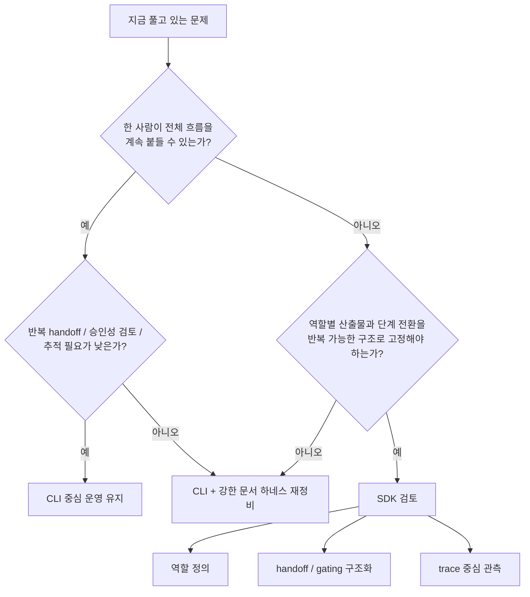

> **핵심 요약**
>
> CLI는 이미 충분히 강하다. 코드를 읽고, 수정하고, 실행하고, 작은 팀의 실전 작업을 밀어붙이는 데 부족하다고 보기 어렵다.
> Agents SDK가 중요해지는 시점은 실행력 부족이 아니라 운영 구조 부족이 드러날 때다.
> 같은 handoff를 반복해야 하고, 단계별 검증과 trace가 필요하고, 사람이 매번 coordinator를 직접 연기하는 비용이 커지면 경계선이 바뀐다.
> 그래서 질문은 "무엇이 더 좋은가"가 아니라 "지금 내가 풀고 있는 문제가 실행 문제인가, 운영 문제인가"다.

## 이 질문이 실무에서 중요한 이유

이쯤 오면 비교 질문이 바뀐다. 이제 중요한 것은 `CLI vs SDK`의 우열이 아니다. 적어도 이 시리즈에서 반복해서 다루는 저장소형 작업, 즉 기능 추가와 테스트, 문서 갱신이 함께 묶인 종류의 일에서는 둘 다 실제 산출물을 만들 수 있다. 하지만 여기서 곧바로 "대체로 결과가 같다"고 일반화하면 곤란하다. 이 글의 관심사는 더 넓은 능력 비교가 아니라, 이런 종류의 작업을 어떤 운영 구조로 밀어붙이느냐다.

그런데 실무에서는 기능 가능 여부보다 운영 비용이 더 빨리 문제를 만든다. 처음에는 사람이 coordinator 역할을 직접 하는 것이 가장 빠르다. 한 세션에서 backend를 먼저 시키고, 그 결과를 보고 frontend로 넘기고, 마지막에 테스트와 문서를 묶어 검토하면 된다. 뒤에서 다시 볼 Top-10 leaderboard 예제도 바로 이런 부류의 작업이다. 이 방식은 단순하고 강하다.

문제는 그 흐름이 반복되기 시작할 때다. 같은 저장소에서 비슷한 종류의 작업이 여러 번 일어나고, 세션이 바뀌고, 역할 분리가 늘어나고, "언제 다음 단계로 넘길 것인가"를 계속 판단해야 하면, 병목은 실행기보다 오케스트레이션 쪽으로 이동한다. 나는 이 지점이 바로 SDK를 검토해야 하는 순간이라고 본다.

OpenAI 공식 자료를 보수적으로 읽으면, Agents SDK 쪽의 핵심은 Codex를 더 똑똑한 모델로 바꾸는 데 있지 않다. 가이드와 notebook이 강조하는 것은 MCP 연결, 역할 분리, Project Manager의 handoff와 guardrail 관리, 그리고 traces 같은 운영 제어 요소다.

그래서 초반에는 이 경계가 잘 안 보인다. 이미 CLI로 꽤 많은 일을 밀 수 있기 때문이다.

## 처음에는 왜 이 경계가 잘 안 보였나

CLI 하네스를 오래 써본 사람은 대체로 이미 많은 것을 해결해 본 경험이 있다. `AGENTS.md`, 저장소 해석 규칙, 작업 분해 습관, 서브에이전트적 역할 분리, 테스트 순서 같은 것들을 잘 설계해 두면 실제 생산성이 꽤 높다. 그래서 SDK를 처음 보면 "결국 이걸 코드로 감싼 것 아닌가?"라는 생각이 자연스럽다.

나도 처음에는 그렇게 봤다. 그 관점이 완전히 틀린 것은 아니다. 실제 코드를 읽고 수정하고 실행하는 실행기는 여전히 강하고, 그 강함은 CLI만으로도 충분히 체감된다.

하지만 그 이해만으로는 중요한 비용을 놓친다. 사람이 coordinator 역할을 잘하고 있었기 때문에, 그 역할 자체를 문제로 인식하지 못하는 것이다. 내가 매번 직접 하던 일을 시스템 구조로 옮길 수 있다는 사실은, 직접 해보지 않으면 비용으로 잘 보이지 않는다.

이 글은 그 숨은 비용을 드러내는 판단 글이다.

여기서 한 가지 용어는 먼저 고정하겠다. 이 글에서 말하는 approval, state, gating은 특정 공식 제품 기능명을 단정하려는 표현이 아니다. 실무 운영 관점에서 "어느 단계에서 확인이 필요하고, 어디까지 진행됐는지, 어떤 조건에서 다음 단계로 넘길지"를 묶어 설명하는 말이다. 이 전제를 깔고 보면 아래 경계가 더 선명해진다.

## 먼저 고정할 원칙: CLI는 기본값으로 충분히 강하다

이 시리즈에서 가장 먼저 고정해야 하는 문장은 이것이다. CLI는 부족한 도구가 아니다. 오히려 많은 팀과 개인 개발자에게는 여전히 가장 실용적인 기본값이다.

CLI가 강한 이유는 단순하다.

- 저장소를 직접 읽고 수정하고 실행하는 힘이 이미 충분하다.
- 사람이 전체 맥락을 잡고 있을 때는 작업 분해와 우선순위 변경이 빠르다.
- 강한 프롬프트와 문서 하네스를 얹으면 재현성도 생각보다 높게 끌어올릴 수 있다.
- 요구사항이 자주 흔들리는 초기 단계에서는 구조를 코드화하기보다 사람이 유연하게 조정하는 편이 싸다.

따라서 SDK 검토는 "CLI가 안 돼서" 올라가는 경로가 아니다. 오히려 CLI로 꽤 멀리 간 뒤, 운영 구조를 사람이 계속 수동으로 붙들고 있는 비용이 커질 때 시작된다.

## CLI가 좋은 경우

CLI는 사람이 주도하는 오케스트레이션에 가장 잘 맞는다. 아래 조건이 많을수록 굳이 SDK까지 올릴 이유가 약하다.

### 1. 한 사람이 전체 맥락을 유지할 수 있다

기능 범위가 좁고, 저장소 이해가 한 사람 머리 안에 안정적으로 들어갈 때는 사람이 직접 분해하고 통합하는 편이 빠르다. 작업이 길지 않고 세션 간 손실도 작다면, 오케스트레이션을 코드로 옮기는 비용이 오히려 더 크다.

### 2. handoff가 자주 반복되지 않는다

frontend, backend, test를 매번 엄격하게 분리하지 않아도 되는 작업이라면 CLI 쪽이 더 자연스럽다. 역할은 프롬프트로 가볍게 나눌 수 있고, 필요할 때만 사람 판단으로 다음 단계로 넘기면 된다.

### 3. 승인성 검토와 추적이 핵심 요구가 아니다

그런 검토 지점이 많지 않고, 나중에 흐름을 상세하게 감사할 필요도 없다면 CLI 세션 기록과 작업 로그로 충분한 경우가 많다.

### 4. 같은 패턴을 코드로 재사용할 필요가 없다

지금의 workflow가 한두 번 쓰고 끝나는 형태라면, 강한 문서 규칙과 체크리스트가 더 가볍다. 운영 구조를 프로그램으로 만들 가치가 생기려면, 그 구조가 반복되어야 한다.

### 5. 요구사항이 아직 자주 바뀐다

MVP나 탐색 단계에서는 "이번엔 backend 먼저, 다음엔 UI 먼저" 같은 전환이 잦다. 이때는 사람이 오케스트레이터인 편이 유리하다. 시스템 구조가 너무 일찍 고정되면 오히려 속도가 떨어질 수 있다.

## SDK가 중요한 경우

반대로 아래 조건이 모이면 경계가 바뀐다. 이때부터는 실행기보다 운영 구조가 더 큰 문제다.

### 1. 같은 역할 분리와 handoff가 반복된다

공식 가이드와 notebook에서 인상적이었던 부분은 Project Manager, Designer, Frontend, Backend, Tester 같은 역할 분리를 예시로 제시한다는 점이었다. 포인트는 역할 이름이 아니라, 누가 무엇을 만들고 어떤 조건에서 다음 단계로 넘기는지를 구조화할 수 있다는 데 있다.

이 구조가 한 번이 아니라 여러 번 반복된다면, 사람의 기억과 숙련도에만 기대는 방식은 금방 불안정해진다.

### 2. 단계 전환 조건을 누락 없이 유지해야 한다

Cookbook notebook은 repeatability, orchestration, observability를 전면에 둔다. 특히 PM이 필요한 artifact를 확인한 뒤 다음 handoff로 넘어가는 예시는 중요하다. 나는 이것을 "산출물 기반 gating"으로 이해했다. 즉, 다음 단계로 넘기기 전에 실제 결과물이 있는지 확인하는 운영 구조다.

이런 조건이 중요해질수록 SDK의 의미가 커진다. 왜냐하면 프롬프트 약속이 아니라 시스템 구조로 그 전환을 표현하고 싶어지기 때문이다.

### 3. trace가 운영 품질의 일부가 된다

공식 자료에서 상대적으로 확실하게 말할 수 있는 부분 중 하나가 traces다. prompt, tool call, handoff, file write, execution duration 같은 흐름을 볼 수 있다는 설명은 단순한 디버깅 편의 이상이다. 작업 경로를 나중에 다시 설명하고 싶고, 운영 흐름을 감사 가능하게 만들고 싶다면 관측성은 사치가 아니라 기본 요건이 된다.

### 4. 세션이 끊겨도 같은 방식으로 다시 시작해야 한다

사람 주도 orchestration의 강점은 유연성이지만, 약점은 사람 의존성이다. 담당자가 바뀌거나 세션이 끊기면, "어디까지 됐는지"와 "다음으로 무엇을 넘겨야 하는지"를 다시 복구해야 한다.

이 복구 비용이 커질수록, 시스템이 workflow의 흐름을 더 많이 쥐는 편이 유리해진다.

### 5. 사람의 coordinator 비용이 이미 병목이다

이 기준이 가장 실무적이다. 내가 직접 계속 판단하고, 직접 넘기고, 직접 검토하고, 직접 누락을 찾는 일이 반복되면, 이미 병목은 모델 성능이 아니라 운영자 시간이다. 이때 SDK는 "더 강한 agent"가 아니라 "사람이 하던 orchestration을 구조화하는 방법"으로 읽히기 시작한다.

## Top-10 Leaderboard 예제로 보는 경계선

시리즈 공통 예제인 Top-10 leaderboard 기능 추가를 다시 가져오자. 요구사항은 이렇다.

- backend: `GET /scores`, `POST /scores`
- frontend: leaderboard UI
- tests: API와 UI smoke test
- docs: README 업데이트

이 작업이 한 번만 일어난다면, 나는 기본적으로 CLI를 선택하겠다. 사람이 backend와 frontend의 순서를 정하고, 테스트와 문서를 마지막에 묶어 검토하면 된다. 이때 중요한 것은 속도와 유연성이지, 운영 구조의 완전한 코드화가 아니다.

하지만 같은 유형의 작업이 계속 이어진다고 가정해 보자. 매번 PM 역할이 요구사항을 정리하고, FE/BE/QA가 순서대로 움직이며, 산출물 확인 뒤에만 다음 단계로 넘어가야 한다면 이야기가 달라진다. 그 순간부터 문제는 leaderboard 기능이 아니라 leaderboard 류의 작업을 계속 같은 방식으로 굴릴 수 있는가로 바뀐다.

이 차이를 가장 짧게 말하면 이렇다.

- 한 번 잘 만드는 문제라면 CLI가 강하다.
- 같은 방식으로 여러 번 굴리는 문제라면 SDK가 의미를 갖기 시작한다.

## 빠르게 판단하는 표

아래 표는 내가 지금 시점에서 쓰는 가장 실용적인 기준이다.

| 질문 | CLI 쪽 신호 | SDK 쪽 신호 |
| --- | --- | --- |
| 누가 오케스트레이션을 맡는가 | 한 사람이 직접 들고 가도 된다 | 시스템이 역할과 흐름을 더 많이 쥐어야 한다 |
| 작업 범위 | 짧고 국소적이다 | 길고 다단계다 |
| handoff 빈도 | 적고 즉흥적이어도 된다 | 반복적이고 조건이 명확해야 한다 |
| 검증 방식 | 마지막에 사람이 통합 검토하면 된다 | 단계별 확인 없이는 누락 비용이 크다 |
| trace 필요성 | 있으면 좋지만 필수는 아니다 | 운영 품질상 거의 필수다 |
| 재개 가능성 | 세션이 끊겨도 복구 비용이 낮다 | 중간 상태를 안정적으로 이어가야 한다 |
| 요구사항 안정성 | 계속 흔들린다 | 비교적 고정되어 있다 |
| 반복 실행 가치 | 낮다 | 높다 |

이 표를 보면 SDK 검토는 대체로 "작업 난이도"보다 "운영 반복성"과 더 강하게 연결된다. 어려운 작업이라서 SDK가 필요한 것이 아니라, 반복 가능한 운영 구조가 필요해서 SDK가 중요해지는 것이다.

## 체크리스트: 지금 나는 어디에 서 있나

아래 항목 중 `예`가 많을수록 SDK를 진지하게 검토할 시점이다.

- 같은 역할 분리와 handoff 패턴을 다음 작업에도 거의 그대로 재사용할 가능성이 높다.
- 다음 단계로 넘기기 전에 artifact 존재 여부나 검증 결과를 확인해야 한다.
- 누가 어떤 지시로 어떤 단계를 거쳤는지 trace가 필요하다.
- 작업이 세션을 넘기거나 사람을 넘기더라도 흐름이 크게 흔들리면 안 된다.
- 사람이 매번 coordinator 역할을 수동으로 수행하는 비용이 이미 눈에 띈다.
- 규칙을 프롬프트로 유도하는 것만으로는 누락 방지가 어렵다고 느낀다.
- 기능 구현보다 workflow 품질 관리가 더 큰 문제로 올라왔다.

반대로 아래 항목이 많으면 아직 CLI가 더 맞다.

- 한 사람이 전체 문맥을 계속 들고 갈 수 있다.
- 작업이 짧고 요구사항 변화가 잦다.
- handoff가 자주 일어나지 않는다.
- 세션 기록과 문서 체크리스트만으로도 충분히 운영할 수 있다.
- 구조를 코드화하는 비용이 당장 얻는 이익보다 커 보인다.

## 내 기준으로 다시 정리

지금 내 기준은 꽤 단순하다.

첫째, 기본값은 CLI다. 사람이 전체 흐름을 붙들 수 있는 동안에는 가장 빠르고 실용적이다.

둘째, SDK는 실행기를 갈아끼우는 선택지라기보다, 반복되는 역할 분리와 handoff를 시스템 구조로 옮기는 선택지에 가깝다.

셋째, 경계선은 작업 난이도보다 운영 반복성에서 갈린다. 같은 흐름을 계속 재현해야 할수록 SDK 쪽 이유가 강해진다.

이렇게 정리하고 나니, `CLI로도 충분한데 왜 SDK를 쓰지?`라는 질문과 `SDK가 더 좋아 보이는데 왜 CLI를 유지하지?`라는 질문이 둘 다 조금 덜 극단적으로 보였다. 둘은 경쟁하는 세대가 아니라, 서로 다른 운영 문제에 맞는 층위다.

## 정리

이 글의 결론은 단순하다. 이 시리즈에서 다룬 저장소형 작업의 기본값은 여전히 CLI다. 하지만 반복 가능한 handoff, 단계별 검증, trace, 재개 가능성이 핵심 요구로 올라오면 질문이 달라진다. 그때는 "더 센 실행기"를 찾는 것이 아니라, 그 실행기를 어떤 운영 구조 안에 둘지를 결정해야 한다.

다음 글에서는 이 판단을 한 단계 더 밀어보려 한다. 언제 SDK가 중요해지는지 이해하고 나면, 왜 이 흐름이 단순한 코딩 도구 비교를 넘어 하나의 운영 시스템 이야기로 확장되는지도 보이기 시작한다. 그 지점이 시리즈 06편의 출발점이다. 동시에 돌아보면, 왜 처음에 SDK가 단지 래퍼처럼 보였는지도 다시 설명될 것이다.
