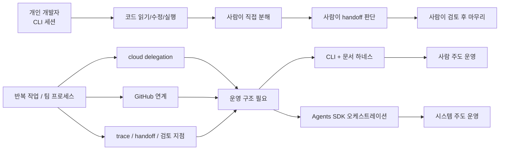

> **핵심 요약**
>
> 이 시리즈의 마지막에서 내가 정리하게 된 결론은 단순하다. CLI는 여전히 매우 강한 작업자이고, 많은 개인 개발과 작은 팀 작업에서는 그 자체로 충분하다.
> 다만 같은 종류의 일을 반복 실행하고, cloud에 위임하고, GitHub와 연결하고, handoff와 trace와 검토 지점을 안정적으로 관리해야 하는 순간 질문이 달라진다.
> 그때부터 핵심은 "AI가 코드를 얼마나 잘 쓰는가"보다 "그 AI 작업 흐름을 어떻게 운영할 것인가"가 된다.
> 그래서 이 글에서 말하는 operating system은 거창한 미래 예언이 아니라, 에이전트 실행을 반복 가능한 운영 체계로 다루기 시작하는 시점에 대한 실무적 표현이다.

## 개인 생산성 도구로서의 AI 코딩은 이미 충분히 강하다

시리즈를 여기까지 끌고 오면서 더 분명해진 것이 있다. 나는 여전히 CLI를 약한 도구라고 생각하지 않는다. 오히려 반대다. 저장소를 읽고, 수정하고, 실행하고, 테스트하고, 문서를 갱신하는 종류의 일에서는 이미 꽤 강한 작업자다. `AGENTS.md`, 작업 규칙, 문서 하네스, 세션 시작 문서 같은 운영 장치를 잘 붙이면 개인 개발자는 물론 작은 팀 단위 작업도 상당히 멀리 밀 수 있다.

그래서 이 시리즈는 처음부터 `CLI는 부족하고 SDK가 정답이다`라는 방향으로 가지 않았다. 실제로 그런 식으로 이해하면 중요한 지점을 놓친다. 앞선 글들에서 정리했듯이, 차이는 실행력의 우열보다 운영 방식의 차이에 있다. CLI는 사람 주도 오케스트레이션에 매우 강하다. 사람이 전체 맥락을 쥐고 있고, 필요한 순간 직접 분해하고, 다음 단계를 판단하고, 마지막에 통합 검토를 하면 된다.

문제는 여기서 끝나지 않는다는 데 있다. 실행이 강하다는 사실과, 그 실행을 반복 가능한 프로세스로 굴릴 수 있다는 사실은 같지 않았다.

## 처음에는 "좋은 코딩 도구"의 연장선처럼 보였다

처음 Codex cloud와 Agents SDK 자료를 봤을 때 내 머릿속 질문은 꽤 단순했다.

`결국 좋은 코딩 에이전트를 더 편하게 쓰는 방법 아닌가?`

이 질문에는 절반쯤 맞는 면이 있다. 공식 노트를 보수적으로 읽으면 Codex cloud는 background 작업, parallel 작업, GitHub 연계, cloud 환경으로의 작업 위임 같은 확장된 실행 맥락을 보여준다. Agents SDK 쪽은 Codex를 MCP server로 연결하고, 그 위에 단일 에이전트 혹은 멀티에이전트 구조를 올리는 orchestration 예시를 보여준다.

표면만 보면 둘 다 "더 넓은 환경에서 더 편하게 쓰는 코딩 도구"처럼 보인다. 실제로 그 해석 자체가 틀렸다고 할 수는 없다. 다만 그 해석만으로는 왜 공식 가이드와 notebook이 repeatability, orchestration, observability, handoff, trace 같은 단어를 전면에 두는지 설명이 잘 되지 않는다.

여기서 시야가 조금 바뀌었다. 이 자료들이 강하게 말하는 것은 "이제 AI가 혼자 다 한다"가 아니었다. 오히려 이미 강한 실행기를 어떤 운영 구조 안에 둘 것인가에 더 가까웠다.

## 반복 실행되는 팀 프로세스의 요구가 질문을 바꾼다

개인 생산성 단계에서는 사람이 coordinator 역할을 직접 해도 크게 불편하지 않다. 내가 지금 무엇을 시키고 있는지 알고 있고, 어떤 파일이 생성돼야 하는지 알고 있고, 어느 시점에 테스트를 돌리고 문서를 업데이트해야 하는지도 대체로 기억한다. 이 상태에서는 CLI와 강한 문서 하네스 조합이 매우 효율적이다.

하지만 작업이 반복되기 시작하면 이야기가 달라진다.

- 비슷한 기능 추가가 계속 들어온다.
- frontend, backend, test, docs 같은 역할 분리가 반복된다.
- 어떤 산출물이 있어야 다음 단계로 넘어갈 수 있는지 점점 중요해진다.
- 세션이 바뀌거나 사람이 바뀌어도 흐름이 크게 흔들리면 안 된다.
- 작업 일부를 cloud에 위임하고 싶어진다.
- GitHub와 연결된 상태에서 background로 진행되는 작업을 더 안정적으로 추적하고 싶어진다.

이 지점부터는 "이 에이전트가 코드를 잘 쓰는가"만으로는 부족하다. 같은 종류의 일을 여러 번 굴릴 때 누가 흐름을 잡고, 누가 다음 단계로 넘기고, 어디서 검토를 멈추고, 무엇을 추적할지가 더 큰 문제가 된다.

즉, 코딩 도구 자체보다 운영 흐름을 설계하는 일이 앞에 나오기 시작한다.

## cloud delegation과 GitHub integration이 왜 운영 문제를 드러내는가

공식 노트에서 조심스럽게 가져올 수 있는 부분은 여기다. Codex cloud는 background 작업을 cloud 환경에서 처리할 수 있고, parallel 작업도 가능하다고 안내한다. GitHub 계정을 연결하면 repository 코드 기반으로 작업하고 PR 생성까지 이어지는 흐름도 제시한다. 이 정도만 봐도 중요한 변화가 보인다.

로컬 CLI 세션 안에서 내가 옆에 붙어서 보는 작업과, background로 맡겨 둔 작업은 관리 방식이 다르다. GitHub에 연결된 저장소에서 cloud에 위임된 작업이 parallel하게 움직이기 시작하면, 자연스럽게 이런 질문이 따라온다.

- 어떤 작업이 지금 진행 중인가
- 어느 작업이 어떤 문맥과 지시를 받았는가
- 어떤 결과가 생성되면 다음 단계로 넘길 것인가
- 사람 검토는 어디서 끼어들어야 하는가
- 실패나 경고를 나중에 어떻게 다시 추적할 것인가

이건 단순히 코딩 모델의 성능 질문이 아니다. background work, parallel work, GitHub integration, cloud delegation이라는 조건 자체가 운영 질문을 강제로 불러온다. 내가 보기에 여기서 conversation이 "개인 생산성 도구"에서 "운영 시스템"으로 넘어간다.

물론 여기서 operating system이라는 표현을 문자 그대로 이해할 필요는 없다. 새로운 운영체제 커널을 말하는 것도 아니고, 모든 개발 조직이 당장 그렇게 가야 한다는 뜻도 아니다. 이 글에서 말하는 operating system은 에이전트 실행과 검토와 상태 전환을 하나의 운영 층위에서 다루기 시작한다는 의미에 가깝다.

## traces, approval, handoff concerns는 부차 요소가 아니었다

앞선 글에서도 여러 번 썼지만, 이 시리즈의 핵심 문장은 여전히 같다. 실행력과 운영은 다른 문제였다.

Agents SDK 가이드와 cookbook notebook에서 특히 눈에 남는 지점은 handoff와 trace다. notebook은 repeatability, scalable orchestration, observability를 전면에 둔다. 공식 가이드도 Project Manager가 handoff와 guardrail을 관리하고, traces를 통해 prompt, tool call, hand-off, file writes, 실행 시간 등을 확인할 수 있는 흐름을 보여준다.

여기서 내가 중요하게 본 것은 두 가지다.

첫째, handoff는 단순한 역할 전환이 아니다. 어떤 산출물이 준비되었는지 보고 다음 역할로 넘기는 구조다. 즉 "다음 에이전트를 부른다"가 아니라 "검증 가능한 문맥과 결과를 넘긴다"에 가깝다.

둘째, trace는 예쁜 디버깅 화면이 아니다. background로 맡긴 작업, GitHub와 연결된 작업, 여러 역할로 분해된 작업에서는 "무슨 일이 있었는지 나중에 다시 볼 수 있어야 한다"는 요구가 생긴다. trace가 운영의 일부가 되는 순간이다.

여기에 approval concern이 겹친다. 공식 노트가 모든 승인 패턴을 하나의 기능 용어로 정리해 주는 것은 아니지만, 실무적으로는 분명한 문제가 남는다. 어떤 단계는 자동으로 통과시켜도 되고, 어떤 단계는 사람 검토나 상위 orchestration의 확인이 필요하다. 이 지점을 프롬프트 약속만으로 관리할 수도 있지만, 반복 작업이 많아질수록 흐름 구조 안에 더 명시적으로 넣고 싶어진다.

그래서 handoff, trace, approval concern은 부가 기능이 아니었다. 반복 가능한 AI 작업 흐름을 만들려는 순간 거의 중심 요구에 가까워졌다.

## 왜 이것이 "툴 비교"보다 "운영 시스템 사고"에 가깝나

이쯤 되면 질문이 바뀐다. 더 좋은 agent를 고르는 것보다, 그 agent를 어떤 시스템 안에서 굴릴 것인가가 중요해진다.

CLI 중심에서는 사람이 오케스트레이터다.

- 사람이 지금 상태를 기억한다.
- 사람이 다음 단계를 결정한다.
- 사람이 handoff 품질을 판단한다.
- 사람이 마지막 검토와 승인 역할을 맡는다.

이 방식은 작고 빠른 작업에 매우 좋다. 유연하고, 요구사항 변화에도 강하다. 그래서 나는 여전히 CLI를 기본값으로 둔다.

반면 SDK 중심에서는 시스템이나 앱 코드가 오케스트레이터 역할을 더 많이 가져간다.

- 역할 정의가 구조화된다.
- handoff 조건을 반복 가능하게 만든다.
- trace를 운영 가시성의 일부로 둔다.
- 검토 지점을 사람의 즉흥 판단에서 흐름 설계 쪽으로 옮긴다.

이 차이는 단순한 편의성 차이가 아니다. 프롬프트 약속과 코드로 강제된 프로세스의 차이다. 시리즈 내내 반복한 문장을 마지막으로 다시 쓰면 이렇다. CLI는 사람 주도 오케스트레이션이고, SDK는 시스템 주도 오케스트레이션이다.

즉, 도구는 비슷해 보여도 운영 모델은 달라진다.

## 그렇다고 SDK가 "다음 세대의 정답"이라는 뜻은 아니다

이 지점에서 가장 조심해야 한다. 시리즈를 여기까지 읽고 나면, 자칫 `결국 미래는 SDK고 CLI는 과도기다`라는 식으로 받아들이기 쉽다. 나는 그렇게 정리하고 싶지 않다.

첫째, 많은 작업은 여전히 CLI로 충분하다. 개인 개발, 탐색적 구현, 요구사항이 자주 흔들리는 작업, 한 사람이 전체 맥락을 안정적으로 쥘 수 있는 작업에서는 CLI가 더 실용적일 때가 많다.

둘째, SDK의 가치는 실행기를 대체하는 데 있지 않다. 이미 강한 실행기를 반복 가능한 운영 구조 안에 두는 데 더 가깝다. 그래서 운영 구조가 아직 필요하지 않다면, 굳이 일찍 올릴 이유도 약하다.

셋째, cloud delegation이나 GitHub integration이 가능하다는 사실 자체가 곧 더 나은 개발 문화를 보장해 주지는 않는다. background로 돌릴 수 있고 parallel하게 위임할 수 있다는 것은 어디까지나 운영 선택지를 넓혀 준다는 뜻이다. 그 선택지를 잘 쓰려면 오히려 더 분명한 orchestration 설계가 필요해진다.

결국 중요한 것은 툴의 위계가 아니라 문제의 종류다. 지금 내가 풀고 있는 것이 "한 번 잘 만드는 문제"인지, 아니면 "여러 번 비슷한 방식으로 굴리는 문제"인지가 더 중요하다.

## 시리즈를 여기서 어떻게 닫고 싶은가

이 시리즈는 처음부터 작은 오해 하나를 풀어 가는 과정이었다. 나는 이미 CLI 기반 하네스를 잘 짜서 꽤 많은 일을 해오고 있었고, 그래서 처음에는 Agents SDK의 가치를 바로 체감하지 못했다. 겉으로 보기엔 결국 Codex를 다른 방식으로 감싼 것처럼 보였기 때문이다.

그런데 공식 가이드와 cookbook notebook, Codex cloud 관련 노트를 보수적으로 다시 읽으면서 문장이 조금씩 바뀌었다.

- 차이는 실행력의 차이보다 운영 방식의 차이였다.
- 차이는 모델의 우열보다 orchestration 구조의 차이였다.
- 차이는 프롬프트 약속보다 코드화된 운영 제어면에 있었다.

그래서 마지막에 남는 결론도 과장될 필요가 없다. AI 코딩은 여전히 좋은 개인 생산성 도구다. 동시에 반복 실행, cloud 위임, GitHub 연계, handoff, trace, 검토 지점이 중요해지는 순간에는 하나의 운영 체계 문제로 보이기 시작한다.

나는 이 변화가 "이제 모든 팀이 AI 운영 시스템을 가져야 한다"는 선언이라고 생각하지 않는다. 다만 에이전트를 진지하게 실무에 넣기 시작하면, 어느 순간부터는 코드 생성 품질보다 운영 구조 품질이 더 중요한 제약이 된다고 본다. 그 경계가 바로 이 시리즈가 계속 따라간 선이었다.

## 정리

시리즈 전체를 한 문장으로 닫으면 이렇다. CLI는 강력한 작업자였고, Agents SDK는 그 작업자를 반복 가능한 운영 체계 안에 넣는 방법이었다.

이 문장을 지금은 조금 더 넓게 읽게 된다. 앞으로의 질문은 "어떤 AI 코딩 도구가 더 센가"만이 아니라, "그 도구와 작업 흐름을 어떤 운영 구조로 굴릴 것인가"가 될 가능성이 크다. 다만 그 변화는 과장된 미래 담론으로 볼 일이 아니라, background 작업과 GitHub 연계와 handoff와 trace를 실제로 다뤄 본 사람이 자연스럽게 맞닥뜨리는 운영 문제로 보는 편이 정확하다.

이 시리즈를 쓰면서 내가 얻은 가장 실용적인 판단 기준도 그래서 단순하다. 사람이 전체 흐름을 붙들 수 있는 동안에는 CLI로 충분하다. 반복되는 역할 분리와 cloud delegation과 검토 흐름을 안정적으로 굴려야 하는 순간에는 SDK 같은 orchestration 구조를 검토할 이유가 생긴다. 그 둘은 경쟁하는 세대라기보다, 서로 다른 운영 문제를 푸는 층위에 가깝다.

여기까지 오면 적어도 하나는 분명해진다. 우리가 다루는 것은 더 이상 "AI가 코드를 써 주는가"만의 문제가 아니다. 어떻게 운영할 것인가의 문제다. 그리고 그 질문을 과장 없이 받아들이는 것, 아마 그것이 지금 시점에서 가장 현실적인 출발점일 것이다.
