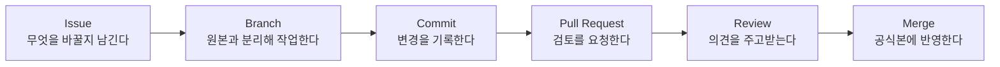

> **핵심 요약**
>
> GitHub의 핵심은 기능 이름을 많이 외우는 것이 아니라, `요청 → 작업 → 기록 → 검토 → 반영`이라는 흐름을 이해하는 것이다. 이 흐름을 잡고 나면 낯선 화면도 훨씬 덜 낯설어진다.

GitHub를 어렵게 느끼는 이유 중 하나는 메뉴를 조각조각 보기 때문입니다.  
`Issues`, `Pull requests`, `Commits`, `Branches`를 따로 외우면 복잡하지만, 흐름으로 보면 생각보다 단순합니다.

## 예시 하나로 보면 더 쉽다

운영 FAQ 문서를 수정한다고 가정해보겠습니다.  
현재 문구가 너무 딱딱해서, 초보 사용자도 이해하기 쉽게 바꾸려는 상황입니다.

이 일을 GitHub 흐름으로 바꾸면 대략 이렇게 됩니다.

1. `FAQ 문구를 더 쉽게 바꾸기`라는 요청을 남긴다.
2. 원본 FAQ 문서를 바로 건드리지 않도록 따로 작업 공간을 만든다.
3. 문장을 수정하고 그 변경을 기록한다.
4. "이 수정안을 반영해도 될까요?"라고 검토 요청을 보낸다.
5. 동료가 읽고 코멘트를 남긴다.
6. 괜찮으면 원본 문서에 합친다.

이게 바로 GitHub의 기본 협업 흐름입니다.

## 1. Issue: 왜 바꾸는지 먼저 남긴다

많은 팀이 처음에는 이 단계를 건너뜁니다.  
하지만 실무에서는 `왜 이 변경을 시작했는가`를 남겨두는 것이 중요합니다.

Issue에는 보통 이런 내용이 들어갑니다.

- 무엇이 문제인지
- 어떤 방향으로 바꾸고 싶은지
- 누가 관련되어 있는지
- 우선순위가 어떤지

즉 issue는 단순 메모가 아니라, **변경의 출발점**입니다.

## 2. Branch: 원본을 바로 건드리지 않는다

그다음에는 따로 작업 공간을 만들어 수정합니다.  
이게 `branch`입니다.

branch를 쓰는 이유는 단순합니다.

- 원본을 안전하게 보호할 수 있고
- 초안 작업이 가능하고
- 리뷰 전까지는 공식본이 바뀌지 않기 때문입니다.

문서 작업으로 비유하면, 본문 원본은 그대로 두고 옆에서 개정안을 만드는 셈입니다.

## 3. Commit: 변경을 한 덩어리씩 남긴다

수정이 일어나면 그 변경을 기록으로 남깁니다.  
이 기록이 `commit`입니다.

중요한 것은 commit이 "최종본만 저장"하는 행위가 아니라는 점입니다.  
작은 변경도 의미 있게 나눠 기록할 수 있습니다.

예를 들어 이런 식입니다.

- `FAQ 첫 문단 표현을 더 쉽게 수정`
- `배송 안내 예시 문장 추가`

이렇게 남기면 나중에 무엇이 어떻게 바뀌었는지 따라가기 쉬워집니다.

## 4. Pull Request: 반영해도 되는지 묻는다

작업이 끝났다고 해서 바로 공식본에 들어가는 것은 아닙니다.  
보통은 `Pull Request`, 즉 검토 요청 단계를 거칩니다.

여기서 중요한 것은 이 단계가 "반영 완료"가 아니라는 점입니다.

Pull Request는 이렇게 읽으면 쉽습니다.

`제가 수정안을 만들어봤습니다. 확인해보고 괜찮으면 원본에 합쳐주세요.`

그래서 제목과 설명에는 단순히 "수정함"보다 아래 정보가 있으면 좋습니다.

- 왜 바꿨는지
- 무엇을 바꿨는지
- 리뷰어가 무엇을 보면 되는지

## 5. Review: 같이 더 나은 결과를 만든다

GitHub의 진짜 힘은 여기서 많이 드러납니다.

Review는 틀린 것을 잡는 심사만이 아닙니다.  
함께 읽고 더 나은 결과를 만드는 대화입니다.

예를 들면 이런 코멘트가 오갈 수 있습니다.

- "좋습니다. 이 표현이 더 자연스럽네요."
- "이 문장은 초보자에게 조금 어려울 수 있어요."
- "정책상 이 표현은 다른 용어로 맞춰주세요."

즉 review는 변경을 막는 과정이 아니라, **안전하고 명확하게 반영하기 위한 합의 과정**입니다.

## 6. Merge: 공식본에 반영한다

검토가 끝났다면 마지막으로 `merge`를 합니다.

이 순간이 초안이 공식본에 들어가는 시점입니다.  
GitHub 흐름을 한 문장으로 정리하면 결국 이렇습니다.

`제안하고, 검토받고, 합치고, 기록을 남긴다.`

## 화면에서 길을 잃지 않는 법

GitHub 웹 화면을 볼 때 아래 메뉴만 먼저 익혀도 충분합니다.

- `Code`: 파일이 있는 곳
- `Issues`: 요청과 할 일을 보는 곳
- `Pull requests`: 수정안 검토 흐름을 보는 곳
- `Files changed`: 무엇이 바뀌었는지 비교하는 곳
- `Conversation`: 변경 배경과 리뷰 대화를 보는 곳

처음부터 모든 메뉴를 볼 필요는 없습니다.  
이 다섯 개만 알아도 기본 흐름을 따라가는 데 큰 문제가 없습니다.

## 흐름만 잡히면 용어가 쉬워진다

GitHub는 기능 이름이 복잡해 보여도 실제 구조는 꽤 일관됩니다.

- 변경 이유는 `issue`
- 작업 공간은 `branch`
- 기록은 `commit`
- 검토 요청은 `pull request`
- 의견 교환은 `review`
- 공식 반영은 `merge`

즉 GitHub는 개발자 전용 마법 상자가 아니라, **변경을 안전하게 다루기 위한 협업 흐름**입니다.

## 이어서 읽기

- [비개발자가 꼭 알아야 할 GitHub 핵심 개념 7가지]()
- [GitHub 웹으로 해보는 첫 실습: 문서 수정부터 Pull Request까지]()
