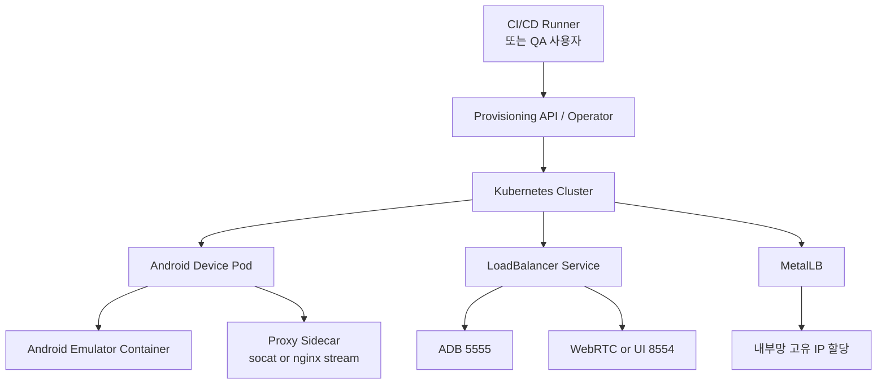
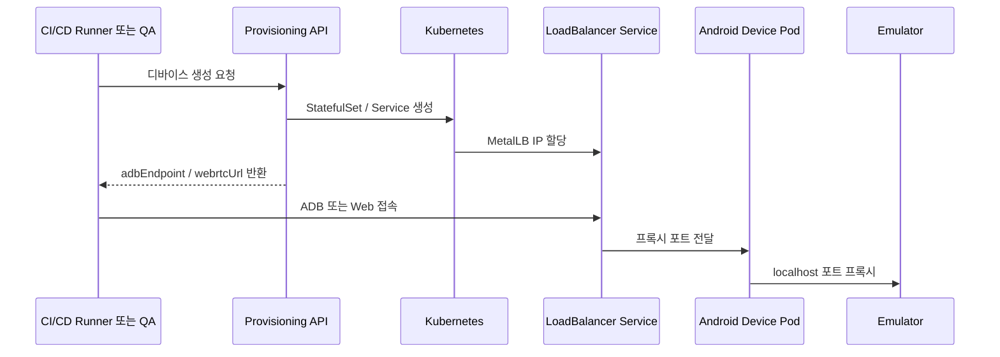
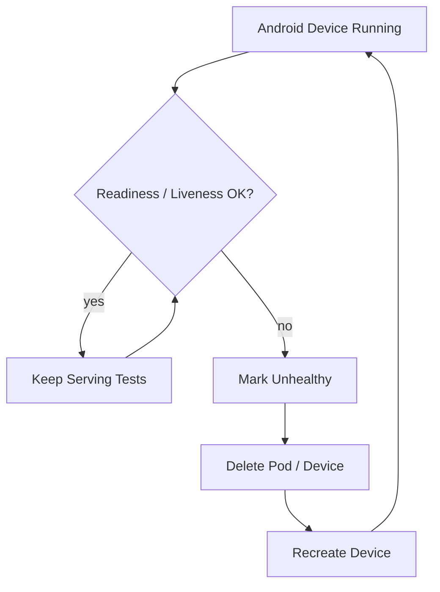

## 한 줄 요약

폐쇄망에서 안드로이드 디바이스 테스트 인프라를 운영하려면, 단순히 에뮬레이터를 띄우는 수준을 넘어 **KVM 기반 성능 확보, localhost 바인딩 우회, 디바이스별 고유 내부 IP 할당, 그리고 API 기반 자동화**까지 한 번에 설계해야 한다.

> **요약 박스**
>
> - 폐쇄망 환경에서는 퍼블릭 Device Farm 대신 **온프레미스 Kubernetes 기반 안드로이드 디바이스 팜**이 현실적인 대안이 된다.
> - 핵심 기술 축은 **KVM**, **사이드카 프록시**, **MetalLB**다.
> - 운영 모델의 핵심 원칙은 **디바이스 1대 = Pod 1개 = Service 1개 = IP 1개**다.
> - 에뮬레이터는 `127.0.0.1` 바인딩 이슈가 잦기 때문에, 별도 프록시 사이드카로 외부 노출을 설계하는 편이 안전하다.
> - 사람 손으로 YAML을 관리하는 순간 운영 한계가 오기 때문에, 최종적으로는 **Provisioning API + Operator/Controller** 구조가 필요하다.
> - 장애 대응은 복구보다 **폐기 후 재생성**이 더 잘 맞는다.
> - 처음에는 `socat + MetalLB + 단일 에뮬레이터`로 시작하고, 이후 운영 표준화와 Cuttlefish 확장으로 가는 흐름이 가장 현실적이다.

---

## 왜 이 글이 필요한가

퍼블릭 클라우드 기반 Device Farm은 편리하다. 하지만 보안 규정이 강한 기업 환경, 특히 외부 인터넷이 차단된 **폐쇄망(Air-Gapped)** 에서는 조건이 완전히 달라진다.

이런 환경에서는 보통 아래 요구사항이 동시에 걸린다.

- 소스 코드와 테스트 데이터가 외부로 나가면 안 된다.
- CI/CD 러너와 테스트 디바이스 사이 지연을 최소화해야 한다.
- 외부 SaaS 의존 없이 내부망만으로 운영 가능해야 한다.
- 감사나 보안 점검 시 인프라 구성과 데이터 흐름을 설명할 수 있어야 한다.

이 조건이 겹치면, 선택지는 자연스럽게 좁혀진다.

**온프레미스 Kubernetes 위에 안드로이드 에뮬레이터를 컨테이너로 올리고, 내부망 전용 디바이스 팜을 직접 운영하는 방식**이다.

이 글은 “왜 필요하냐”보다, 실제로 **어떤 식으로 설계하고, 어디서 막히고, 어떤 순서로 구현하는 게 현실적인지**에 초점을 맞춘다.

---

## 전체 구조 먼저 보기

먼저 큰 그림을 보면 아래와 같다.



이 구조에서 중요한 건 “디바이스를 하나의 독립된 네트워크 단위로 본다”는 점이다.

즉, 안드로이드 디바이스 한 대를 단순 프로세스가 아니라 아래처럼 다룬다.

- 독립된 Pod
- 독립된 Service
- 독립된 내부 IP
- 독립된 생명주기

운영 모델이 장비 관리에서 **인프라 리소스 관리**로 바뀌는 지점이 여기다.

---

## 왜 물리 디바이스 팜보다 에뮬레이터 팜이 나은가

처음에는 USB 허브에 여러 안드로이드 디바이스를 연결하는 방식이 빠르게 보일 수 있다. 하지만 규모가 조금만 커져도 현실적인 문제가 쏟아진다.

### 물리 디바이스 팜에서 자주 만나는 문제

- 배터리 스웰링
- 케이블 접촉 불량
- USB 허브 장애
- 디바이스 교체 비용 증가
- 병렬 확장 한계
- 테스트 세션 관리 복잡도 증가

반면 Kubernetes 기반 가상 디바이스 팜은 운영 관점이 다르다.

### 에뮬레이터 팜의 장점

- API로 생성/삭제 가능
- CPU/메모리 기준 스케줄링 가능
- 테스트 종료 후 즉시 회수 가능
- 상태를 선언형 리소스로 관리 가능
- CI/CD 파이프라인과 구조적으로 맞물리기 쉬움

물리 디바이스는 결국 “장비 운영” 문제를 계속 끌고 가게 되지만, 가상 디바이스는 “플랫폼 운영” 문제로 전환할 수 있다.

---

## 핵심 설계 원칙

이 글 전체를 관통하는 원칙은 딱 두 가지다.

### 1. 디바이스 1대 = Pod 1개 = Service 1개 = IP 1개

디바이스 팜에서는 일반 웹 서비스처럼 여러 Pod 뒤에 하나의 Service를 두는 식으로 가면 안 된다. 그렇게 하면 테스트 세션이 꼬이기 쉽다.

하나의 안드로이드 디바이스는 반드시 **고정된 네트워크 식별자와 독립된 접속 경로**를 가져야 한다.

### 2. 복구보다 재생성

에뮬레이터는 DB가 아니다. 애매하게 살아 있는 상태가 가장 위험하다.

그래서 운영 원칙은 보통 이쪽이 더 낫다.

- 이상 상태 감지
- 살리려 하지 않음
- 폐기
- 새 디바이스 재생성

장애 대응 철학이 이 방향으로 잡혀 있어야 운영이 단순해진다.

---

## 구축 전에 준비해야 할 것들

### 1. 베어메탈 Kubernetes 노드

에뮬레이터 성능의 핵심은 **KVM**이다. 따라서 워커 노드는 가능하면 VM이 아니라 **베어메탈**이어야 한다.

중첩 가상화 위에 다시 에뮬레이터를 올리면, 체감 성능이 확 떨어지는 경우가 많다.

### 2. 내부 레지스트리

폐쇄망에서는 외부 이미지를 직접 pull 할 수 없다. 아래 이미지는 미리 내부망으로 반입해두는 편이 좋다.

- Android Emulator 이미지
- socat 또는 nginx stream 이미지
- MetalLB controller / speaker 이미지
- Provisioning API 이미지
- Operator / Controller 이미지

### 3. MetalLB용 유휴 IP 대역

디바이스마다 고유 IP를 붙일 계획이라면, 내부망에서 사용 가능한 IP 풀을 별도로 확보해야 한다.

예를 들면 다음과 같은 대역이다.

```text
192.168.100.240 - 192.168.100.250
```

### 4. 전용 노드 분리 정책

에뮬레이터는 CPU와 메모리를 많이 사용한다. 일반 워크로드와 섞기보다 전용 노드로 분리하는 편이 좋다.

예시:

- `devicefarm.kvm=true` 라벨
- `devicefarm=emulator:NoSchedule` taint

---

## 1단계. KVM 가능한 노드 만들기

첫 단계는 아주 단순하지만 가장 중요하다.

**이 노드가 진짜 KVM을 사용할 수 있는가?**

먼저 확인한다.

```bash
egrep -c '(vmx|svm)' /proc/cpuinfo
ls -l /dev/kvm
```

필요하면 커널 모듈도 로드한다.

```bash
modprobe kvm
modprobe kvm_intel   # Intel CPU
# 또는
modprobe kvm_amd     # AMD CPU
```

그리고 Kubernetes에서 전용 노드로 라벨/taint를 준다.

```bash
kubectl label node worker-01 devicefarm.kvm=true
kubectl taint node worker-01 devicefarm=emulator:NoSchedule
```

여기서 실제 운영상 가장 중요한 포인트는 이것이다.

> 에뮬레이터 컨테이너가 `/dev/kvm`에 접근할 수 있어야 한다.

즉 Pod 스펙에서 `/dev/kvm`을 `hostPath`로 마운트해야 하고, 보통은 `privileged` 또는 그에 준하는 권한 구성이 필요하다.

---

## 2단계. localhost 바인딩 문제와 사이드카 프록시

실제 구현에서 가장 자주 막히는 포인트가 여기다.

안드로이드 에뮬레이터 프로세스가 종종 아래처럼 **`127.0.0.1`에만 바인딩**되어 있다.

- ADB: `127.0.0.1:5555`
- WebRTC/gRPC: `127.0.0.1:8554`

이 경우 Pod에 IP가 있어도 외부에서 바로 붙을 수 없다.

그래서 필요한 게 **사이드카 프록시**다.

### 핵심 아이디어

- 에뮬레이터 컨테이너는 그대로 둔다.
- 같은 Pod 안에 프록시 컨테이너를 하나 더 둔다.
- 프록시가 외부에서 들어온 요청을 받아서 Pod 내부 `127.0.0.1`로 전달한다.

이 흐름을 그림으로 보면 아래와 같다.


### 왜 같은 포트를 그대로 쓰지 않나

같은 Pod 안의 컨테이너는 네트워크 네임스페이스를 공유한다. 그래서 프록시가 같은 포트를 잡으려고 하면 충돌할 수 있다.

그래서 실무에서는 보통 다음처럼 설계한다.

- 프록시 listen 포트: `15555`, `18554`
- Service 외부 포트: `5555`, `8554`
- Service targetPort: `15555`, `18554`

이렇게 해두면 구조가 단순하고 충돌도 피할 수 있다.

---

## Pod 설계 예시

초기 PoC는 단일 Pod로도 충분하다. 하지만 운영에서는 `StatefulSet` 패턴이 더 관리하기 편하다.

```yaml
apiVersion: apps/v1
kind: StatefulSet
metadata:
  name: emulator-001
spec:
  serviceName: emulator-001
  replicas: 1
  selector:
    matchLabels:
      app: emulator-001
  template:
    metadata:
      labels:
        app: emulator-001
    spec:
      nodeSelector:
        devicefarm.kvm: "true"
      tolerations:
        - key: "devicefarm"
          operator: "Equal"
          value: "emulator"
          effect: "NoSchedule"
      containers:
        - name: emulator
          image: registry.local/android/emulator:api34
          securityContext:
            privileged: true
          resources:
            requests:
              cpu: "4"
              memory: "8Gi"
            limits:
              cpu: "4"
              memory: "8Gi"
          volumeMounts:
            - name: kvm
              mountPath: /dev/kvm

        - name: adb-proxy
          image: registry.local/net/socat:1.8
          command:
            - sh
            - -c
            - >
              socat TCP-LISTEN:15555,fork,reuseaddr TCP:127.0.0.1:5555
          ports:
            - containerPort: 15555

        - name: webrtc-proxy
          image: registry.local/net/socat:1.8
          command:
            - sh
            - -c
            - >
              socat TCP-LISTEN:18554,fork,reuseaddr TCP:127.0.0.1:8554
          ports:
            - containerPort: 18554

      volumes:
        - name: kvm
          hostPath:
            path: /dev/kvm
            type: CharDevice
```

이 구조의 장점은 꽤 명확하다.

- 에뮬레이터 이미지를 직접 수정하지 않아도 된다.
- 포트 노출 정책을 프록시 컨테이너에서 분리 관리할 수 있다.
- 나중에 `socat`에서 `nginx stream`으로 전환하기 쉽다.

---

## socat과 nginx stream 중 무엇을 쓸까

| 항목 | socat | nginx stream |
|---|---|---|
| 구성 난이도 | 매우 낮음 | 중간 |
| 리소스 오버헤드 | 매우 낮음 | 낮음 |
| 기능 | 단순 TCP 포워딩 | TLS, 로그, 타임아웃, 연결 관리 |
| 적합한 용도 | ADB 포트 노출, 빠른 PoC | 운영 환경, WebRTC, 보안/관측성 강화 |

정리하면 아래처럼 보면 된다.

- **PoC나 ADB 중심 자동화**라면 `socat`
- **운영 표준화, TLS, 로깅, 장기 운영**까지 보려면 `nginx stream`

보통은 `socat`으로 먼저 작게 시작하고, 운영 안정화 단계에서 `nginx stream`으로 가는 흐름이 가장 현실적이다.

---

## 3단계. MetalLB로 디바이스별 고유 IP 부여하기

베어메탈 Kubernetes에서는 `Service type: LoadBalancer`가 클라우드처럼 자동으로 동작하지 않는다. 그래서 **MetalLB**가 필요하다.

폐쇄망 단일 서브넷이라면 우선 **Layer 2 모드**가 가장 단순하다.

```yaml
apiVersion: metallb.io/v1beta1
kind: IPAddressPool
metadata:
  name: emulator-pool
  namespace: metallb-system
spec:
  addresses:
    - 192.168.100.240-192.168.100.250
---
apiVersion: metallb.io/v1beta1
kind: L2Advertisement
metadata:
  name: emulator-pool-adv
  namespace: metallb-system
spec:
  ipAddressPools:
    - emulator-pool
```

이제 디바이스별 Service는 아래처럼 가져간다.

```yaml
apiVersion: v1
kind: Service
metadata:
  name: emulator-001
  annotations:
    metallb.universe.tf/address-pool: emulator-pool
spec:
  type: LoadBalancer
  externalTrafficPolicy: Local
  selector:
    app: emulator-001
  ports:
    - name: adb
      port: 5555
      targetPort: 15555
    - name: webrtc
      port: 8554
      targetPort: 18554
```

### 왜 `externalTrafficPolicy: Local`이 중요한가

이 옵션은 디바이스 팜에서는 사실상 핵심 옵션이다.

- 트래픽이 다른 노드의 Pod로 우회되지 않는다.
- 소스 IP를 보존할 수 있다.
- 특정 디바이스 세션이 엉뚱한 Pod로 섞일 가능성을 줄여준다.

즉, “웹 트래픽 분산”이 아니라 “디바이스 세션 고정”이 중요한 구조에 더 잘 맞는다.

---

## 접속 흐름은 어떻게 보나

생성 요청부터 실제 접속까지를 시퀀스로 보면 더 명확하다.



이렇게 되면 사용자나 파이프라인은 내부 구조를 몰라도 된다. 결국 필요한 건 두 가지뿐이다.

- 어떤 디바이스를 요청할지
- 반환된 endpoint로 어떻게 붙을지

---

## 수동 테스트는 어떻게 하나

Service가 생성되면 MetalLB가 내부망 IP를 할당한다.

```bash
kubectl get svc emulator-001 -w
```

예를 들어 `192.168.100.55`가 붙었다면 ADB는 아래처럼 붙는다.

```bash
adb connect 192.168.100.55:5555
```

브라우저 기반 UI가 있다면 이런 식이다.

```text
http://192.168.100.55:8554
```

초기 단계에서는 이 수동 접속이 반드시 먼저 성공해야 한다. 이걸 건너뛰고 자동화부터 들어가면 문제를 추적하기 훨씬 어려워진다.

---

## 4단계. 사람이 아니라 API가 디바이스를 만들게 하기

여기까지 되면 YAML로 수동 생성은 가능하다. 하지만 운영은 여기서 멈추면 안 된다.

실제 현업에서는 사람이 매번 `StatefulSet`과 `Service`를 직접 생성하지 않는다. 이 시점부터 필요한 건 **Provisioning API + Kubernetes Controller**다.

### 추천 구조: CRD + Controller

예를 들어 `AndroidDevice`라는 커스텀 리소스를 정의할 수 있다.

```yaml
apiVersion: devicefarm.internal/v1alpha1
kind: AndroidDevice
metadata:
  name: emulator-001
spec:
  apiLevel: "34"
  profile: "pixel-6"
  cpu: 4
  memory: 8192
  exposeAdb: true
  exposeWebrtc: true
```

컨트롤러는 이 리소스를 보고 자동으로 아래를 만든다.

- StatefulSet
- LoadBalancer Service
- 필요 시 ConfigMap / Secret
- 상태(Status) 필드

즉, 사용자 관점에서는 “안드로이드 디바이스를 요청”하는 것이고, 실제 인프라 리소스 생성은 컨트롤러가 감춘다.

---

## API 흐름은 이렇게 설계하는 편이 깔끔하다

### 생성 요청

```http
POST /devices
```

요청 예시:

```json
{
  "apiLevel": 34,
  "profile": "pixel-6",
  "cpu": 4,
  "memoryMb": 8192,
  "webrtc": true
}
```

### 백엔드가 수행하는 일

- 입력 검증
- `AndroidDevice` CR 생성
- StatefulSet / Service 생성 대기
- `status.loadBalancer.ingress[0].ip` 확인
- readiness 확인
- 접속 정보 반환

### 응답 예시

```json
{
  "deviceId": "emulator-001",
  "adbEndpoint": "192.168.100.55:5555",
  "webrtcUrl": "http://192.168.100.55:8554",
  "status": "READY"
}
```

### 삭제 요청

```http
DELETE /devices/emulator-001
```

삭제 시에는 아래까지 같이 정리되어야 한다.

- StatefulSet
- Service
- PVC가 있다면 PVC
- 로그/아티팩트 메타데이터

---

## 5단계. CI/CD와 연결되는 순간 운영성이 달라진다

디바이스 팜은 사람이 브라우저로 직접 만지는 시스템이 아니라, 결국 **파이프라인이 호출하는 인프라 서비스**가 된다.

예를 들면 Jenkins나 GitLab Runner에서는 아래처럼 연결할 수 있다.

```bash
DEVICE_JSON=$(curl -s -X POST http://devicefarm.internal/devices \
  -H 'Content-Type: application/json' \
  -d '{
        "apiLevel": 34,
        "profile": "pixel-6",
        "cpu": 4,
        "memoryMb": 8192,
        "webrtc": false
      }')

ADB_ENDPOINT=$(echo "$DEVICE_JSON" | jq -r .adbEndpoint)
DEVICE_ID=$(echo "$DEVICE_JSON" | jq -r .deviceId)

adb connect "$ADB_ENDPOINT"
./gradlew connectedAndroidTest

curl -X DELETE "http://devicefarm.internal/devices/$DEVICE_ID"
```

이 흐름이 자리 잡으면, 개발자나 QA는 Kubernetes나 MetalLB를 몰라도 된다.

그냥 다음만 하면 된다.

1. 테스트용 안드로이드 디바이스 요청
2. 테스트 실행
3. 반납

이게 플랫폼화의 시작점이다.

---

## 운영 안정성을 위한 health check 설계

에뮬레이터는 완전히 죽는 경우보다, **애매하게 살아 있는 상태**가 더 위험하다. 그래서 readiness와 liveness를 분리해서 봐야 한다.

### Readiness

이 디바이스가 **테스트를 받아도 되는가**를 본다.

예시:

- sidecar 포트 open 여부
- `adb shell getprop sys.boot_completed == 1`
- boot animation 종료 여부

### Liveness

이 Pod를 **계속 살려둬도 되는가**를 본다.

예시:

- ADB 응답 없음
- child process 누수
- 장시간 세션 비정상 유지
- WebRTC 포트 hung 상태

### 운영 철학

문제가 생기면 수리하려 하지 말고, **재생성 가능한 자원으로 운영하는 것**이 더 낫다.

이를 그림으로 보면 아래처럼 단순한 self-healing 루프가 된다.



---

## 더 깊이 가면 Cuttlefish도 고려하게 된다

앱 테스트 수준을 넘어 AOSP, 프레임워크, 시스템 이미지, 펌웨어 수준 검증이 필요해지면 기존 AVD 기반만으로는 한계가 온다. 이때 검토할 수 있는 선택지가 **Cuttlefish**다.

### Cuttlefish가 필요한 경우

- 순정 AOSP 기반 검증이 필요할 때
- 프레임워크 수정본 테스트가 필요할 때
- 시스템 레벨 동작을 실제 디바이스에 더 가깝게 보고 싶을 때

### 추가 작업 포인트

#### 1. 커널 모듈 자동 로드

```bash
modprobe vhost_vsock
modprobe vhost_net
```

부팅 시 자동 로드:

```bash
cat <<EOF >/etc/modules-load.d/cuttlefish.conf
vhost_vsock
vhost_net
EOF
```

#### 2. 아티팩트 반입 파이프라인

폐쇄망에서는 외부 빌드 결과를 바로 사용할 수 없으므로 보통 아래 흐름이 필요하다.

- 연결 가능한 구간에서 AOSP/Cuttlefish 빌드 아티팩트 확보
- 승인 절차를 거쳐 내부 저장소로 반입
- 내부 이미지 빌더가 새 컨테이너 이미지 생성
- 내부 레지스트리에 push

#### 3. 런타임 전환

컨테이너 시작 시 `launch_cvd`를 실행하도록 연결한다.

```bash
/opt/cuttlefish-android/bin/launch_cvd
```

핵심은 네트워크 모델과 자동화 모델은 유지한 채, **런타임만 AVD에서 Cuttlefish로 교체**하는 식으로 가는 것이다.

---

## 운영하면서 반드시 부딪히는 문제들

### 1. 중첩 가상화 성능 문제

프라이빗 클라우드 VM 위에 다시 에뮬레이터를 올리면 성능이 급격히 떨어질 수 있다. 가능하면 베어메탈이 낫다.

### 2. GPU 공유 문제

UI 렌더링이나 3D 테스트가 많아지면 GPU가 필요해진다. 하지만 Kubernetes는 기본적으로 GPU를 독점 할당하는 구조에 가깝다.

검토 대상은 보통 아래와 같다.

- GPU Device Plugin
- NVIDIA time-slicing
- Intel shared device 설정

### 3. MetalLB L2의 확장 한계

초기에는 L2 모드가 가장 단순하다. 하지만 규모가 커지면 ARP/NDP 부담이 생긴다. 수백~수천 디바이스 수준이면 결국 BGP 모드를 검토하게 된다.

### 4. ADB 좀비 프로세스

지속적인 연결/해제 반복 과정에서 ADB 하위 프로세스가 정리되지 않는 경우가 생긴다. 그래서 백엔드가 상태를 감시하고 비정상 디바이스를 교체하는 구조가 필요하다.

---

## 현실적인 구현 순서

처음부터 모든 걸 한 번에 만들 필요는 없다. 보통 아래 순서가 가장 안전하다.

### Phase 1

- 베어메탈 Kubernetes 준비
- `/dev/kvm` 노출
- Emulator + socat sidecar 구성
- MetalLB L2 구성
- 수동 ADB 연결 확인

### Phase 2

- `AndroidDevice` CRD 설계
- Controller 구현
- Provisioning API 구현
- CI/CD 연동
- readiness / liveness / self-healing 추가

### Phase 3

- Cuttlefish 이미지 파이프라인 추가
- 커널 모듈 자동화
- 시스템 레벨 테스트 워크로드 분리
- 필요 시 GPU 공유 및 BGP 검토

이 순서가 좋은 이유는 단순하다. 처음부터 운영 자동화까지 한 번에 잡으려고 하면, 어디서 문제가 생겼는지 분리해서 보기가 어려워진다.

---

## 마무리

폐쇄망에서 안드로이드 디바이스 팜을 만든다는 것은 단순히 “에뮬레이터를 컨테이너에 넣는 일”이 아니다.

실제로는 아래 세 가지를 동시에 해결해야 한다.

- **성능**: KVM으로 가속할 것
- **접속성**: localhost 바인딩을 사이드카로 우회할 것
- **운영성**: MetalLB와 자동화 계층으로 디바이스를 API화할 것

이 구조만 잘 잡히면 퍼블릭 Device Farm 없이도 내부망에서 충분히 운영할 수 있다.

- 온디맨드 안드로이드 디바이스 생성
- 대규모 병렬 테스트
- CI/CD 자동화
- 폐쇄망 내 통제 가능한 테스트 인프라 운영

그리고 가장 중요한 건, 처음부터 완벽한 플랫폼을 만들려 하지 않는 것이다.

처음에는 아래 조합이면 충분하다.

- `socat`
- `MetalLB`
- 단일 에뮬레이터
- 수동 ADB 연결 성공

대신 아래 원칙만은 처음부터 가져가야 한다.

> **디바이스 1대 = Pod 1개 = Service 1개 = IP 1개**  
> **문제 생기면 복구보다 재생성**

이 두 가지를 지키면, 나중에 운영을 키울 때 훨씬 덜 고생하게 된다.

---

## 다음에 이어서 보면 좋은 주제

- 실제 배포 가능한 `StatefulSet / Service / CRD` 템플릿 정리
- `socat` 대신 `nginx stream`으로 운영 표준화하는 방법
- Jenkins / GitLab Runner와 완전히 묶는 Provisioning API 설계
- Cuttlefish 기반 시스템 레벨 테스트 팜으로 확장하는 방법
